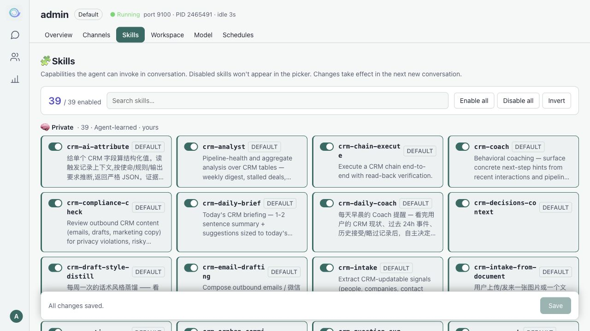
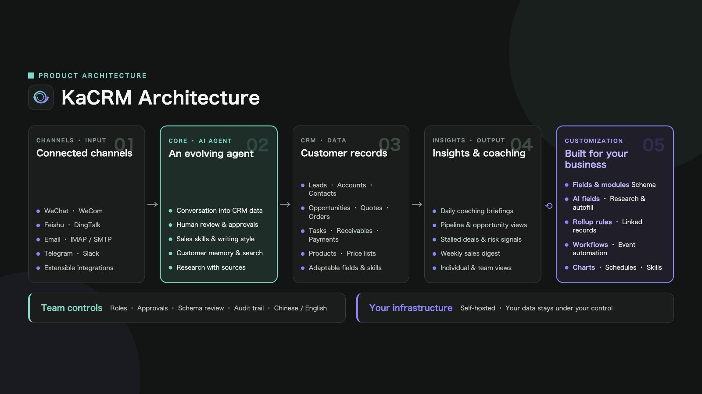

<p align="center">
  
</p>

<h1 align="center">KaCRM</h1>

<p align="center"><strong>English</strong> · <a href="README.zh-CN.md">简体中文</a></p>

**Customer management, team collaboration, and AI agents in one workspace.**

KaCRM is a conversational AI CRM powered by [Hermes Agent](https://github.com/NousResearch/hermes-agent). Manage customers and sales processes through configurable business views, use natural language to find information and work with CRM tools, and govern operations with permissions, approvals, and audit trails.

[User Guide](docs/user-guide.html) · [Deployment Guide](docs/deployment.md) · [Hermes Upgrade Notes](docs/2026-10-12-hermes-v0.21.6-upgrade.md) · [Script Reference](scripts/README.md) · [Report an Issue](https://github.com/dfar2008/kacrm/issues)


*Sales metrics, the opportunity funnel, and an AI assistant on one dashboard.*

## Product Tour

These English illustrations were localized from existing screenshots with image-editing tools; they show earlier interface examples rather than captures of the current live English UI. Model names, screen details, and available features depend on the current version and configuration. The linked user and deployment guides are currently in Chinese; the application supports Chinese and English.

### Shape your customer records around your business

Organize fields, layouts, and options in the module builder, and configure AI-assisted field filling to match your team's workflow.


### Give agents the skills your team needs

Organize customer research, meeting preparation, email drafting, and sales analysis as skills that can be enabled or disabled for each agent.



### Schedule recurring work

Create agent tasks, inspect their schedules and execution status, and manage daily reminders and periodic summaries.


## Why KaCRM

Sales work spans customer profiles, business documents, conversation history, and team messages. KaCRM connects this information so teams can use CRM views and AI assistants with the same business data.

- **Keep customer context together.** Connect leads, accounts, contacts, opportunities, and sales documents with related records and interaction history.
- **Work through conversation.** Configure agent models and skills, access CRM tools in chat, and retain conversation history.
- **Adapt to your workflow.** Configure modules, fields, views, and workflows, with roles, departments, and approvals for collaboration.
- **Run on your infrastructure.** Store business data in PostgreSQL and configure your own model providers and messaging channels.

## Features

| Capability | What it provides |
| --- | --- |
| Customer and sales management | Leads, accounts, contacts, opportunities, products, quotes, and orders, with related records and interaction history. |
| Configurable business views | Custom fields, filters, display columns, and views, including lists, kanban boards, and calendars. |
| AI agent workspace | Model, channel, skill, workspace, and scheduled-task settings, with web chat and conversation history. |
| Model integrations | Multiple providers, compatible APIs, and local models, with default and auxiliary models and multi-model collaboration. |
| Messaging channels | Configuration for platforms such as Feishu/Lark, DingTalk, and WeCom. Capabilities depend on platform credentials and runtime dependencies. |
| Permissions and approvals | Users, roles, departments, data access scopes, approval flows, and operation auditing. |
| Workflows and background jobs | Business workflows, asynchronous processing, and periodic jobs using Celery workers and beat. |
| Memory and analytics | Memory and entity relationships, business dashboards, usage statistics, and audit information. |
| Chinese and English UI | Interface language and theme settings. |

## User Guide

The illustrated [KaCRM User Guide](docs/user-guide.html) covers initial setup, chat, CRM, dashboards, agents, tasks, and administration. After cloning the repository, open `docs/user-guide.html` in a browser to read it or print it to PDF. GitHub displays the HTML source; download the repository to view the guide with its bundled images.

## Getting Started

### Requirements

| Component | Requirement or purpose |
| --- | --- |
| Git | Clone the repository and the Hermes submodule. |
| Python / uv | Python 3.11; create a virtual environment and install dependencies with uv. |
| Node.js / npm | Node.js 20.19+ or 22.12+ to build the web interface. |
| PostgreSQL / pgvector | Business data, identities, conversations, and vector storage. |
| Redis | Message broker and result backend for Celery tasks. |
| PgBouncer | Database connection pool used by the full supervisor deployment. |

Agent conversations require an available model service. Messaging integrations require credentials for the corresponding platforms.

### 1. Clone the repository

```bash
git clone --recurse-submodules https://github.com/dfar2008/kacrm.git
cd kacrm
```

Hermes Agent is pinned to **v0.21.6**, commit `818c13be1dc4fd28987e1e881a9408224afd4535`. CRM extensions and cloud integration live in `hermes-patches/`. Upgrades must validate both the submodule and its patches.

### 2. Initialize the environment

Follow [sections 2–4 of the Deployment Guide](docs/deployment.md#2-获取源码安装依赖):

1. Create a Python virtual environment and install the main project, Hermes, and agent runtime dependencies.
2. Copy `.env.example` to `.env` and configure the database, administrator account, session secret, and profile directories.
3. Apply the Hermes patches, run Alembic migrations, and initialize the database with the seed command.
4. Install frontend dependencies and build the interface.

The current database migration head is **0115**. The Deployment Guide includes complete commands, configuration examples, and verification steps. Legacy Docker Compose development examples are not the installation path for this version.

### 3. Start the web interface

After initialization, run from the repository root:

```bash
set -a
. ./.env
set +a
export PYTHONPATH="$PWD:$PWD/hermes"
.venv/bin/python -m uvicorn hermes_cloud.app.dev_server:app \
  --host 127.0.0.1 --port 8765
```

Open [http://127.0.0.1:8765/app/](http://127.0.0.1:8765/app/) and sign in with the administrator account configured during initialization.

This command starts the web/API service. For background jobs and scheduled workflows, configure Redis and PgBouncer as described in the [Deployment Guide](docs/deployment.md#5-启动和验收), then start the full supervisor:

```bash
bash scripts/run_cloud_supervised.sh
```

### 4. Configure your workspace

1. Open the agent's **Model** page, configure a provider and credentials, select a default model, and test the connection.
2. Send a message in chat and verify the agent's status and actual response.
3. Create a test CRM record and check reading, editing, and related information.
4. Configure roles, departments, approvals, messaging channels, and scheduled tasks for your team.

See the [Deployment Guide](docs/deployment.md) for production deployment, health checks, backups, rollback, and upgrade validation.

## Product Architecture



*Capability overview: channel integrations, agents, customer data, sales insights, and business customization. Availability depends on the version and deployment configuration.*

## Technology Stack

| Layer | Technologies and responsibilities |
| --- | --- |
| Web interface | React, TypeScript, and Vite for chat, CRM, agent management, and administration. |
| Backend | Python, FastAPI, and SQLAlchemy for authentication, business APIs, and profile management. |
| Agent runtime | Hermes Agent and local patches for model calls, skills, tools, and the messaging gateway. |
| Data | PostgreSQL, pgvector, and Alembic for business storage and database migrations. |
| Background jobs | Redis, Celery workers, and Celery beat for asynchronous processing and periodic scheduling. |

### Repository Layout

```text
kacrm/
├── frontend/       # Web interface
├── hermes_cloud/   # APIs, business services, and cloud integration
├── hermes/         # Pinned upstream agent submodule
├── hermes-patches/ # CRM extensions and upstream compatibility patches
├── alembic/        # Database migrations
├── tests/          # Business and integration tests
├── scripts/        # Development, verification, and operations scripts
├── deploy/         # Deployment templates
└── docs/           # Deployment, upgrade, and user documentation
```

## Development and Verification

After installing development dependencies, applying patches, and configuring an isolated test environment:

```bash
# Backend: exclude the existing dev_server collection issue and live model evaluations
PYTHONPATH="$PWD/hermes:$PWD" .venv/bin/python -m pytest tests/hermes_cloud/ \
  --import-mode=importlib --ignore=tests/hermes_cloud/test_dev_server.py \
  -m 'not llm_eval' -q

# Frontend tests and build; tests require Bun
cd frontend
bun test
npm run build
```

Real PostgreSQL tests require a separate test database and `HERMES_TESTS_REAL_PG=1`. Some historical tests still need to be aligned with the current schema and removed features; these commands do not imply that the entire regression suite passes.

Capture Hermes extension changes in `hermes-patches/` so they can be replayed on fresh checkouts and future upgrades. See the [Script Reference](scripts/README.md) for script purposes and execution requirements.

## Contributing

Report bugs and suggest improvements through [Issues](https://github.com/dfar2008/kacrm/issues), or submit changes through [Pull Requests](https://github.com/dfar2008/kacrm/pulls).

- Include reproduction steps, expected behavior, actual results, and your environment. Remove credentials and customer data from logs.
- Explain the problem, scope, and verification results for each change.
- Include migrations for schema changes and replayable patches for agent extensions.
- Follow the naming conventions in [AGENTS.md](AGENTS.md).

## License and Acknowledgments

KaCRM's original code is licensed under **[AGPL-3.0](LICENSE)** (`AGPL-3.0-only`), with **separate commercial licensing** available by agreement with the relevant rights holders. AGPL allows commercial use subject to its terms; alternative rights, such as proprietary distribution or hosting a modified version without AGPL source-offer obligations for the covered code, require a separate written agreement. See [Licensing](LICENSING.md) for scope, third-party notices, contribution rights, and inquiries.

Thanks to [Hermes Agent](https://github.com/NousResearch/hermes-agent) and its contributors for the agent runtime. The upstream license is available in [hermes/LICENSE](hermes/LICENSE); it does not automatically cover KaCRM's own code.
