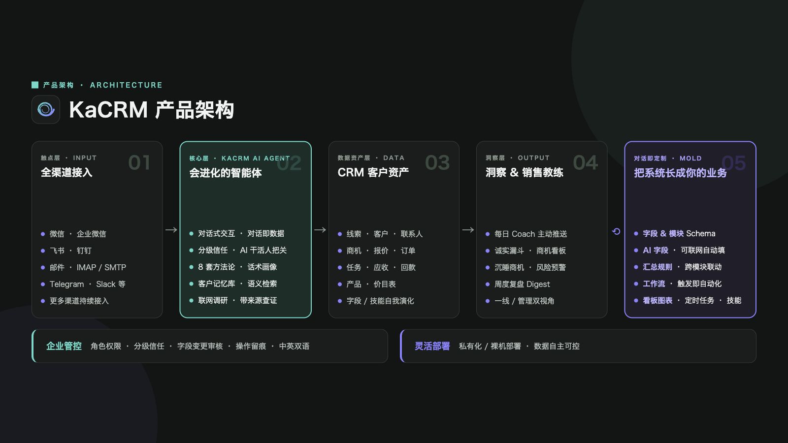
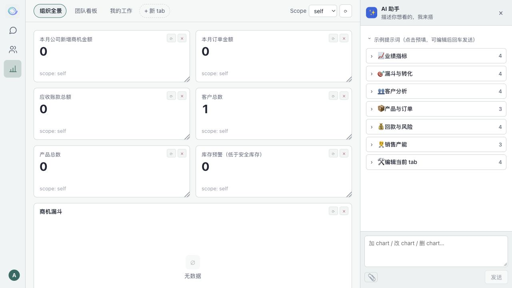
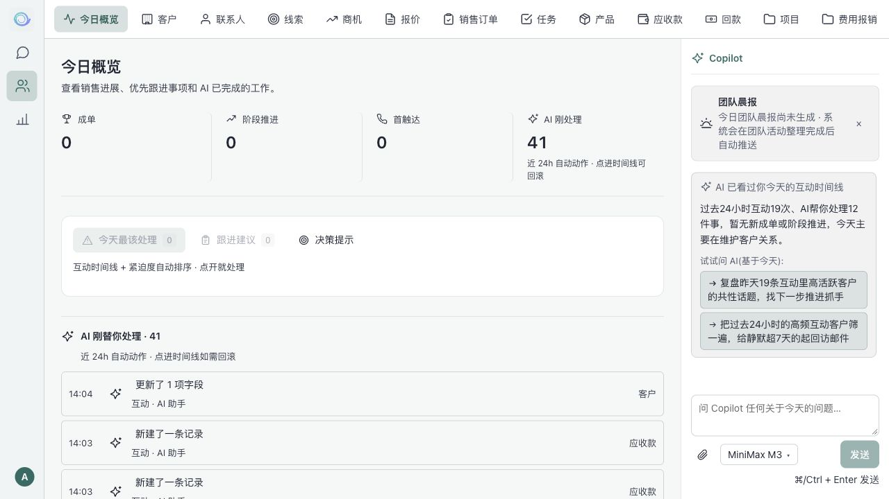
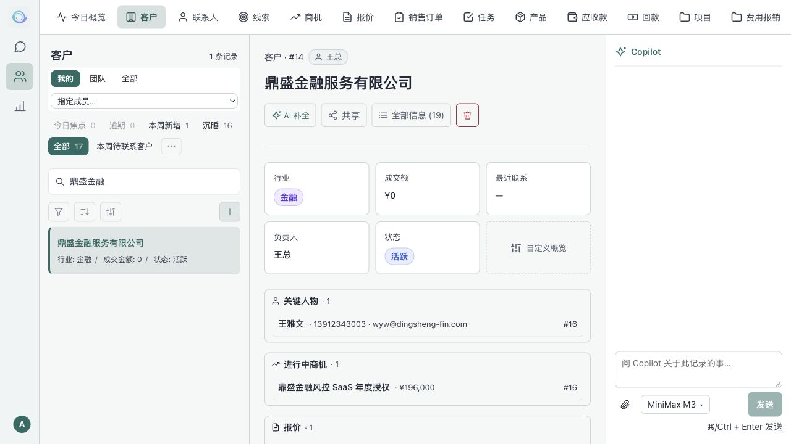
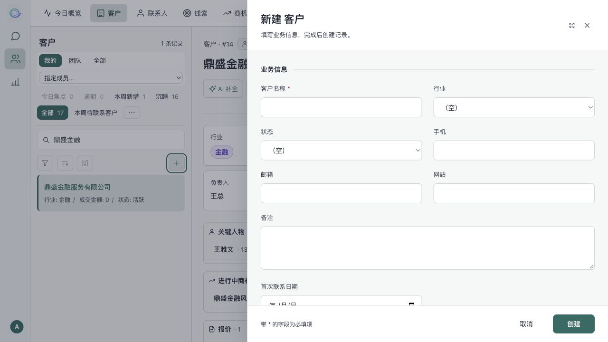

<p align="center">
  
</p>

<h1 align="center">KaCRM</h1>

<p align="center"><a href="README.md">English</a> · <strong>简体中文</strong></p>

**把客户管理、团队协作与 AI Agent 放在同一个工作空间。**

KaCRM 是基于 [Hermes Agent](https://github.com/NousResearch/hermes-agent) 的对话式 AI CRM。通过业务视图管理客户与销售流程，通过自然语言查询信息、整理跟进记录和调用 CRM 工具，并用权限、审批与审计管理业务操作。

[使用指南](docs/user-guide.md) · [部署指南](docs/deployment.md) · [Hermes 升级记录](docs/2026-10-12-hermes-v0.21.6-upgrade.md) · [脚本说明](scripts/README.md) · [反馈问题](https://github.com/dfar2008/kacrm/issues)

## 产品架构



*产品能力概览：渠道接入、Agent、客户资产、销售洞察与业务定制。具体可用能力取决于版本和部署配置。*



*业务仪表盘：将销售指标、商机漏斗与 AI 助手放在同一页面。*

## 产品导览

以下界面截图于 2026-10-15 使用 Codex 内置浏览器采集，展示新版 KaCRM 的实际界面。截图数据仅用于说明布局，不代表业务成效；具体功能和模型取决于部署配置。中英文界面分别实拍，来源见[截图说明](assets/user-guide/SOURCES.md)。

### 围绕客户安排每天的工作

CRM 首页集中展示销售进展、优先跟进事项和 AI 动作；客户详情统一展示业务摘要、关联记录、互动时间线与 Copilot。





新增记录采用分组表单，支持关系选择和小数金额；外观可跟随系统，也可固定为浅色或深色。



### 配置适合团队的业务字段

在模块管理中组织字段、调整布局和选项，并配置 AI 自动填充，让客户档案贴合团队的业务流程。


### 为 Agent 配置业务技能

将客户研究、会议准备、邮件起草与销售分析等能力组织为技能，按 Agent 启用或禁用。


### 让重复工作按计划执行

为 Agent 设置定时任务，查看调度、运行状态与下一次执行时间，管理每日提醒和周期总结。


## 为什么选择 KaCRM

销售工作同时发生在客户资料、业务单据、沟通记录和团队消息中。KaCRM 将这些信息连接起来，让团队在同一套业务数据上使用 CRM 界面与 AI 助手。

- **围绕客户开展工作**：从线索、客户、联系人到商机和销售单据，保留关联资料与跟进记录。
- **用对话处理业务**：为 Agent 配置模型与技能，在聊天中访问 CRM 工具，并保留会话历史。
- **适配自己的业务流程**：配置模块、字段、视图和工作流，结合角色、部门与审批管理协作。
- **部署在自己的基础设施上**：业务数据存放于 PostgreSQL，模型和消息渠道由管理员自行配置。

## 核心功能

| 能力 | 说明 |
| --- | --- |
| 客户与销售管理 | 管理线索、客户、联系人、商机、产品、报价和订单，查看关联记录与互动历史。 |
| 可配置业务界面 | 自定义字段、筛选条件、显示列与视图，使用列表、看板、日历等方式组织记录。 |
| AI Agent 工作空间 | 管理 Agent 的模型、渠道、技能、工作区与定时任务，支持 Web 对话与历史会话。 |
| 模型接入 | 配置多个模型提供商、兼容 API 和本地模型，设置默认模型、辅助模型及多模型协作。 |
| 消息渠道 | 提供飞书、钉钉、企业微信等渠道接入配置；具体能力取决于渠道凭据及运行依赖。 |
| 团队权限与审批 | 管理用户、角色、部门、数据访问范围、审批流程与操作审计。 |
| 工作流与异步任务 | 配置业务工作流，使用 Celery worker 与 beat 执行异步处理和周期任务。 |
| 记忆与数据分析 | 查看记忆与实体关联，结合业务仪表盘、使用统计和审计信息分析工作情况。 |
| 中英文界面 | 提供中文与英文界面及主题设置。 |

## 使用指南

[KaCRM 使用指南](docs/user-guide.md) 包含首次设置、对话、CRM、看板、Agent、任务与系统管理的图文说明，可在 GitHub 直接阅读。Markdown 为主要维护版本；[HTML 打印版](docs/user-guide.html) 保留排版快照，克隆仓库后可在浏览器打开并打印为 PDF。

## 开始使用

### 环境要求

| 组件 | 要求或用途 |
| --- | --- |
| Git | 获取主仓库及 Hermes 子模块。 |
| Python / uv | Python 3.11，使用 uv 创建虚拟环境并安装依赖。 |
| Node.js / npm | Node.js 20.19+ 或 22.12+，用于构建 Web 界面。 |
| PostgreSQL / pgvector | 保存业务数据、身份、会话与向量数据。 |
| Redis | 为 Celery 异步任务提供消息队列与结果后端。 |
| PgBouncer | 完整 supervisor 部署使用的数据库连接池。 |

模型对话需要可用的模型服务；消息渠道需要各平台的接入凭据。

### 1. 获取源码

```bash
git clone --recurse-submodules https://github.com/dfar2008/kacrm.git
cd kacrm
```

当前 Hermes Agent 固定为 **v0.21.6**，提交为 `818c13be1dc4fd28987e1e881a9408224afd4535`。本仓库通过 `hermes-patches/` 提供 CRM 扩展与云端集成，升级需同时验证子模块与补丁。

### 2. 初始化环境

按照 [部署指南第 2–4 节](docs/deployment.md#2-获取源码安装依赖) 完成以下步骤：

1. 创建 Python 虚拟环境，安装主项目、Hermes 与 Agent 运行依赖。
2. 从 `.env.example` 创建 `.env`，设置数据库、管理员账号、会话密钥与 profile 目录。
3. 应用 Hermes 补丁，执行 Alembic 迁移与初始化 seed。
4. 安装前端依赖并构建界面。

当前数据库迁移 head 为 **0115**。部署指南包含完整命令、配置示例和验证步骤；当前版本只支持源码部署，不支持 Docker 部署。

### 3. 启动 Web 界面

完成初始化后，在仓库根目录执行：

```bash
set -a
. ./.env
set +a
export PYTHONPATH="$PWD:$PWD/hermes"
.venv/bin/python -m uvicorn hermes_cloud.app.dev_server:app \
  --host 127.0.0.1 --port 8765
```

打开 [http://127.0.0.1:8765/app/](http://127.0.0.1:8765/app/)，使用初始化时配置的管理员账号登录。

此命令启动 Web/API 服务。需要异步任务与定时工作流时，按 [部署指南](docs/deployment.md#5-启动和验收) 配置 Redis、PgBouncer，并启动完整 supervisor：

```bash
bash scripts/run_cloud_supervised.sh
```

### 4. 完成首次配置

1. 在 Agent 的「模型」页面配置提供商、凭据与默认模型，测试连接。
2. 在聊天页面发送一条消息，确认 Agent 运行状态与实际回复。
3. 在 CRM 中创建一条测试记录，检查读取、编辑和关联信息。
4. 根据团队需要配置角色、部门、审批、消息渠道与定时任务。

生产部署、健康检查、备份、回滚与升级门禁见 [部署指南](docs/deployment.md)。

## 技术架构

| 层级 | 技术与职责 |
| --- | --- |
| Web 界面 | React、TypeScript、Vite；提供聊天、CRM、Agent 管理和管理后台。 |
| 服务端 | Python、FastAPI、SQLAlchemy；提供认证、业务 API 与 profile 管理。 |
| Agent 运行时 | Hermes Agent 与本地补丁；提供模型调用、技能、工具和消息网关。 |
| 数据存储 | PostgreSQL、pgvector、Alembic；保存业务数据并管理数据库迁移。 |
| 后台任务 | Redis、Celery worker、Celery beat；处理异步任务与周期调度。 |

### 源码结构

```text
kacrm/
├── frontend/       # Web 界面
├── hermes_cloud/   # API、业务服务与云端集成
├── hermes/         # 固定版本的上游 Agent 子模块
├── hermes-patches/ # CRM 扩展与上游兼容补丁
├── alembic/        # 数据库迁移
├── tests/          # 业务与集成测试
├── scripts/        # 开发、验证和运维脚本
├── deploy/         # 部署模板
└── docs/           # 公开部署与升级文档
```

## 开发与验证

安装开发依赖、应用补丁并配置独立测试环境后，可运行：

```bash
# 服务端测试：排除旧开发服务器接线测试及真实模型评测
PYTHONPATH="$PWD/hermes:$PWD" .venv/bin/python -m pytest tests/hermes_cloud/ \
  --import-mode=importlib --ignore=tests/hermes_cloud/test_dev_server.py \
  -m 'not llm_eval' -q

# 前端测试与构建；测试命令需要安装 Bun
cd frontend
bun test
npm run build
```

真实 PostgreSQL 测试须使用独立测试库并设置 `HERMES_TESTS_REAL_PG=1`。仓库仍有部分历史测试需要与当前 schema 和已移除功能同步，测试命令不代表全套回归已通过。可使用 `make test-backend`、`make test-frontend`、`make lint` 和 `make build-frontend` 执行对应检查；`make ci` 串联测试、配置检查和前端构建，并保留失败退出状态。

修改 Hermes 扩展时，将对应改动同步到 `hermes-patches/`，使新检出和后续升级能够重放。脚本的用途与执行条件见 [脚本说明](scripts/README.md)。

## 参与贡献

欢迎通过 [Issues](https://github.com/dfar2008/kacrm/issues) 提交问题与建议，通过 [Pull Requests](https://github.com/dfar2008/kacrm/pulls) 提交改进。

- 报告问题时，说明复现步骤、预期行为、实际结果和运行环境；日志中移除密钥与客户数据。
- 提交改动时，说明解决的问题、影响范围及验证结果。
- 数据结构变更需包含迁移；Agent 扩展需包含可重放补丁。
- 项目命名约定见 [AGENTS.md](AGENTS.md)。

## 许可证与致谢

KaCRM 自有代码采用 **[AGPL-3.0](LICENSE)**（`AGPL-3.0-only`），并提供需与相关权利人另行签约的**独立商业授权**。AGPL 允许符合条款的商业使用；闭源分发、托管修改版本时针对协议覆盖代码的源码提供义务豁免等权利，须通过独立书面协议约定。授权范围、第三方声明、贡献权利与咨询入口见 [授权说明](LICENSING.md#kacrm-授权说明)。

感谢 [Hermes Agent](https://github.com/NousResearch/hermes-agent) 及其贡献者提供 Agent 运行时。上游代码的许可证见 [hermes/LICENSE](hermes/LICENSE)，其授权范围不自动覆盖 KaCRM 自有代码。
