# Kacrm User Guide

**English** · [简体中文](user-guide.md)

This Markdown guide can be read directly on GitHub. It covers the same ten chapters as the Chinese guide. The [Chinese HTML print edition](user-guide.html) remains a layout snapshot for browser printing or PDF export; Markdown is the maintained format.

This guide describes source-deployed installations. Model calls, external channels, skill writing, scheduled delivery, and approvals depend on configured services, tools, and permissions; illustrations and demo conversations do not establish that a deployment has passed acceptance checks.

## Contents

- [Product Overview](#product-overview)
- [Getting Started and Navigation](#getting-started-and-navigation)
- [Chat Workspace](#chat-workspace)
- [Customers and CRM](#customers-and-crm)
- [Dashboards](#dashboards)
- [My AI Agent](#my-ai-agent)
- [Tasks](#tasks)
- [Administration](#administration)
- [Personal Settings](#personal-settings)
- [Frequently Asked Questions and Support](#frequently-asked-questions-and-support)

This guide was adapted from the existing product manual. All illustrations in this English guide use English text and are stored separately from the Chinese guide's images. They were localized from historical screenshots with image-editing tools and are not live captures of the current English UI. Model names, interface details, and available capabilities depend on the version and configuration. See the [Deployment Guide](deployment.en.md) for installation and upgrades. The interface-tour video is not bundled with this repository.

## Product Overview

Kacrm is a conversational AI CRM that connects customer records, interactions, and sales work with a personal agent. Use natural language to record information, follow up with customers, and manage opportunities. Configured channels and scheduled tasks can bring communication history and follow-up reminders into the same workspace.

### Five core ideas

| Capability | Purpose |
| --- | --- |
| Conversation becomes data | Extract customer information from conversations and use CRM tools to update records. |
| Connected channels | Bring WeChat, WeCom, Feishu/Lark, DingTalk, and email interactions into customer timelines. |
| AI execution with human oversight | Use trust levels and approvals to control which actions can run automatically and which need review. |
| Reusable knowledge | Retain writing preferences, sales playbooks, fields, and skills, and refine them with feedback. |
| Scheduled assistance | Run configured coaching and follow-up tasks and deliver results through connected channels. |

*Figure 1-1. English product architecture illustration.*

## Getting Started and Navigation

### 2.1 Sign in

1. Open your Kacrm installation's URL and go to the sign-in page.
2. Enter the **email or username** and **password** provided by your administrator, then select **Sign in**.
3. Your first sign-in initializes your personal AI workspace, called a profile.

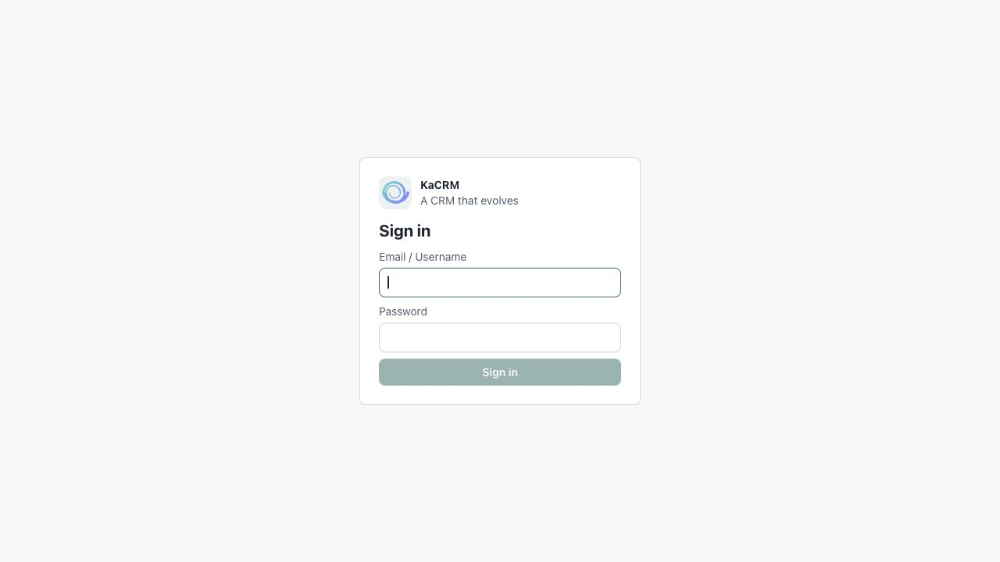

*Figure 2-1. Sign-in page.*

Administrators create accounts and assign roles in **User Management**. Contact your administrator if you need a password reset. The account menu at the bottom of the navigation bar lets you switch between **Chinese and English**.

### 2.2 Three-step setup wizard

On first sign-in, the setup wizard helps configure your workspace. You can also visit `/app/setup`. It has three tabs: **Quick Setup**, **Conversation Demo**, and **CRM Interface Tour**. Complete Quick Setup first, then explore the demonstrations.

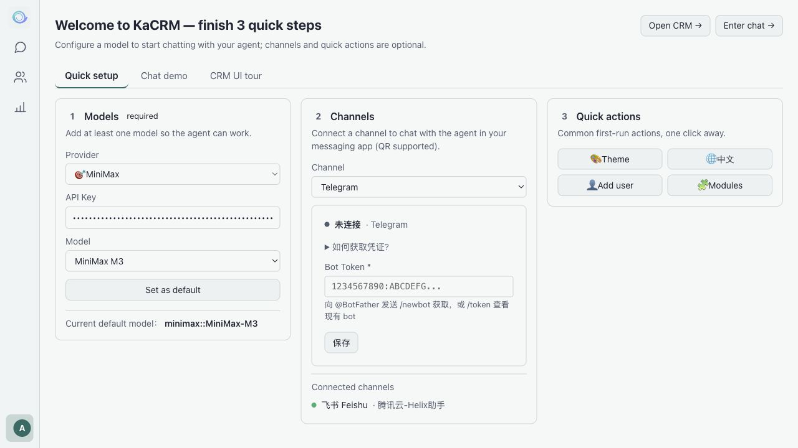

*Figure 2-2. Quick Setup: model, channel, and shortcuts.*

| Step | What to do |
| --- | --- |
| **1. Model** — required | Choose a provider such as DeepSeek, MiniMax, or OpenAI; enter its API key; choose a model; and set it as the default. The agent needs at least one usable model. |
| **2. Channel** | Connect a supported channel such as Feishu/Lark, WeChat, WeCom, DingTalk, or email. Available setup methods depend on the platform. |
| **3. Shortcuts** | Choose a theme, switch languages, add users, or configure business modules. |

Default CRM skills are enabled by the initial configuration. Manage additional skills under **My Agent → Skills**; required default skills may be protected from removal or disabling.

| Shortcut | Action |
| --- | --- |
| Theme | Open the theme picker and apply a theme immediately. |
| Language | Switch between Chinese and English; the button shows the language you will switch to. |
| Add User | Open user management to add a member; requires the relevant permission. |
| Configure Modules | Open the module and field builder, including its AI assistant; requires administrative permission. |

Administrative shortcuts are hidden when you lack permission. **Go to Chat** lets you leave the wizard at any time. Users with CRM access can also select **Go to CRM**. Channels can be configured later in My Agent.

The **Conversation Demo** illustrates eight common interactions:

| Step | Example |
| --- | --- |
| Lead conversion | “Create a lead for Yunfan Technology, contact Mr. Zhang, interested in self-hosting. Convert it into an account and opportunity.” |
| New field | “Add an industry dropdown to account records.” |
| AI-assisted field | “Add a company background field and fill it using web research.” Review confidence indicators and source references. |
| New module | “Create an expense reimbursement module.” |
| Document intake | Upload an invoice and ask the agent to draft an expense record. Review extracted amount, category, issue date, and vendor; verify uncertain values. |
| Automation | “Create a high-priority follow-up when a deal exceeds one million.” Critical and external actions follow the configured approval policy. |
| Dashboard | “Create a bar chart of sales by month.” |
| Scheduled briefing | Configure a morning follow-up briefing delivered through your chosen channel. |

Use the chapter controls to jump between steps, pause, or replay, then select **Try Chat** to begin.

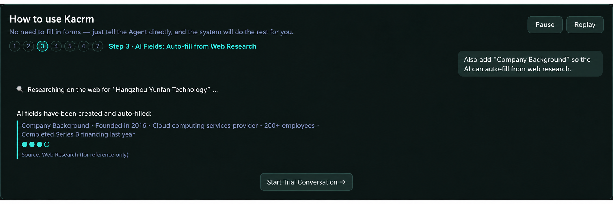

*Figure 2-3. Conversation demo showing an AI-assisted research field.*

The **CRM Interface Tour** introduces these eight parts of the interface through a recording with language-specific captions, when the video assets are installed:

| Chapter | What it demonstrates |
| --- | --- |
| Account list | Search, business segments, and My / Team / All data scopes. |
| List fields | Customize the information displayed in each record row. |
| Five views | Table, cards, kanban, timeline, and calendar; save named views. |
| Summary chips | Choose which key fields appear at the top of a record. |
| All Information | Inspect and edit fields in a one- or two-column drawer; ask Copilot to help. |
| Panel widths | Resize list, detail, and Copilot panels; double-click a divider to reset. |
| Record Copilot | Read summaries and suggested questions, select a model, and work with the current record. |
| Approvals | Review critical agent actions and approve or reject them. |

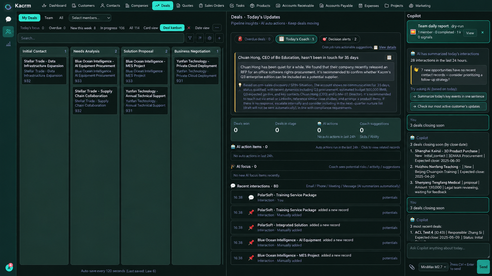

*Figure 2-4. Interface-tour example. The recording is not included in this repository.*

### 2.3 Find your way around

The left navigation bar has three main module icons and an account avatar at the bottom. Select the avatar to open the account menu. Entries appear according to your permissions.

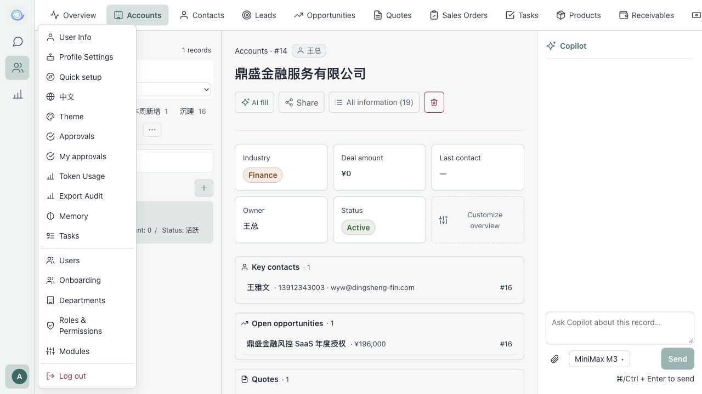

*Figure 2-5. Main modules and account-menu shortcuts.*

| Location | Entries |
| --- | --- |
| Main navigation | **Chat**, **CRM**, and **Dashboards**. |
| Account menu: personal | User Info, Profile Settings, language switch, and sign out. |
| Account menu: work | My Approvals, Approvals, unclaimed messages where available, Memory, and Tasks. |
| Account menu: administration | Users, Departments, Roles and Permissions, Modules, Onboarding, Token Usage, and Export Audit. |

The agent status indicator uses **green** for a running agent and **red** for an agent that is not running. Open profile settings to inspect its status and configuration.

### 2.4 Ask the usage assistant

Ask the agent for help in web chat or a connected channel:

- “How do I add a chart to the dashboard?”
- “How do I connect Feishu?”
- “Why did my skill change not take effect?”

The agent can consult its usage-guide skill and explain the steps. It may research gaps in the guide and save reusable knowledge. Check its answers against the actual interface and your permissions.

## Chat Workspace

Chat is the main workspace for collaborating with your agent. Describe what you want in natural language, inspect its responses and tool calls, and retain the conversation history. Configured coaching features may also surface suggested work for today.

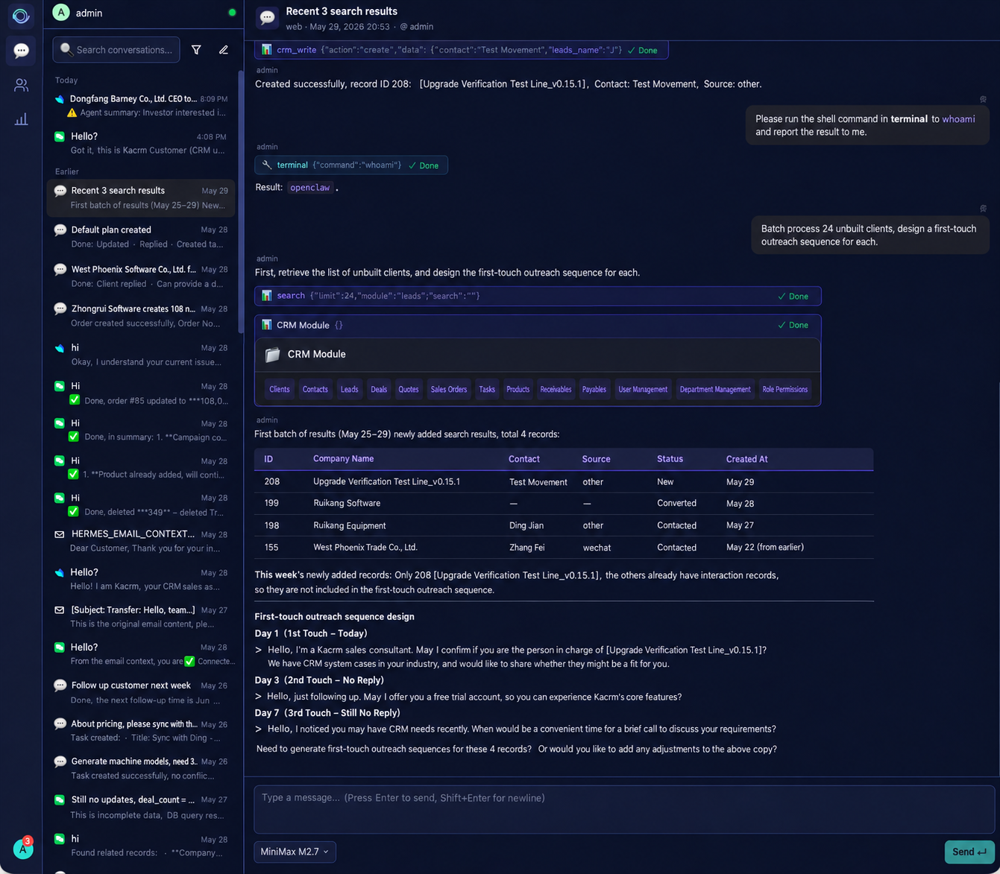

*Figure 3-1. Chat workspace.*

### 3.1 Manage conversations

- **New conversation:** Select the compose button to start a new session.
- **History:** Conversations are grouped by Today, Yesterday, and Earlier, with channel icons, titles, and previews.
- **Search and archive:** Filter by title or content; use the filter control to switch between active and archived conversations.
- **Actions:** Hover over a conversation and open its menu to archive, restore, or delete it.

### 3.2 Messages and agent actions

- **Send:** Enter a message at the bottom. Enter sends; Shift+Enter adds a new line. Choose a model before sending if needed.
- **Streaming replies:** Responses appear progressively. Select Stop to interrupt generation.
- **Attachments:** Use the paperclip to attach images, PDFs, spreadsheets, Word documents, CSV, or text files. Remove an attachment card before sending if necessary. The agent can read supported content and associate attachments with CRM records.
- **Research:** Ask for company background, financial information, or recent news. Review the sources and verify the conclusions.
- **Tool calls:** Expand tool cards to inspect the tool name, progress or result status, inputs, and outputs.

### 3.3 Today's workspace

When available, tabs organize suggested work; empty tabs are hidden:

- **Priority items:** Records ranked using coaching hints, inactivity, and overdue dates. Select an item to open the record and prefill Copilot.
- **Today's Coach:** Draft follow-up messages that you can review and copy.
- **Decision hints:** Action-oriented suggestions that prefill the AI input when selected.

### 3.4 Weekly AI report

When there is no active conversation, a weekly report may summarize the agent's recent work, such as deals advanced and leads added, with coaching hints linking to related records.

## Customers and CRM

CRM modules organize sales records and their relationships. Communication and operations feed into interaction timelines; fields and views can be configured for your business.

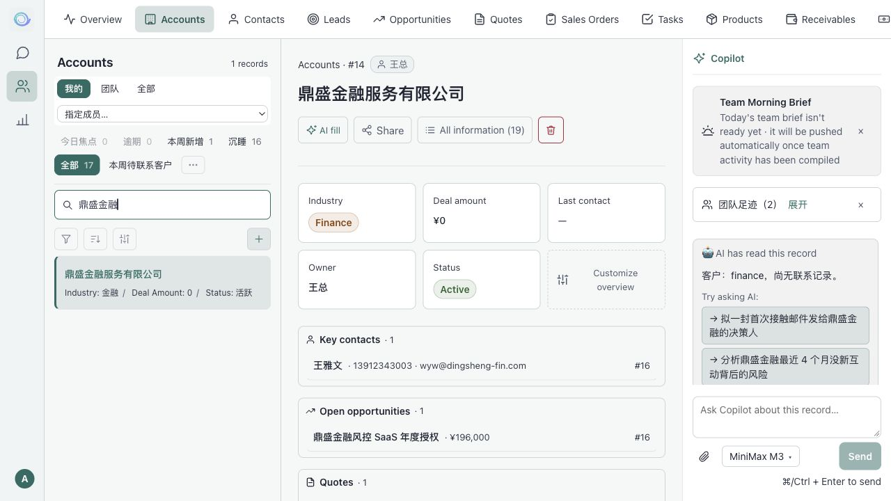

*Figure 4-1. CRM records and interaction history.*

### 4.1 Business modules

| Group | Modules |
| --- | --- |
| Customer data | Leads, Accounts, and Contacts. |
| Sales transactions | Opportunities, Quotes, and Sales Orders. |
| Execution and payments | Tasks, Receivables, Payments, and Products. |

The Interaction Timeline tab provides a broader view of recent interactions.

### 4.2 Record lists

- **Search and segments:** Search names and notes, or select a business segment.
- **Data scope:** Switch between My, Team, and All, subject to permissions. Administrators can filter by member.
- **Row information:** Inspect names, module-specific indicators, interaction counts, and recent or next contact dates. Overdue dates are highlighted.
- **Undo:** Eligible recent changes may display a quick undo action within the configured window, described in the original interface as 120 seconds.
- **Views:** Switch between table, cards, kanban, timeline, and calendar. Save named custom views. Kanban can support dragging cards between stages.
- **Create:** Select the plus button and complete text, date, number, currency, dropdown, checkbox, user, and relationship fields as needed. Supported currency inputs depend on the field parser.

### 4.3 Record details

- **Summary chips:** Key fields such as stage, amount, or deadline appear at the top. Administrators can configure the displayed fields.
- **All Information:** Open the full-field drawer, switch between one and two columns, and edit values. Field-level AI controls can prefill a Copilot request.
- **Interaction timeline:** Inspect email, calls, meetings, messages, notes, and system actions in reverse chronological order. System events can include audit details and eligible undo actions.
- **Manual notes:** Record contact details, progress, and the next follow-up date.
- **Product lines:** Edit quantities, unit prices, discounts, and taxes on quotes or orders; calculated subtotals and totals are shown.
- **Sharing:** Owners or administrators can grant colleagues view or edit access.
- **AI memory:** Inspect remembered facts and related people, with links to the memory library.

### 4.4 Record Copilot and AI Focus

- **Analysis card:** Copilot can show a summary, cautions, and suggested questions for the current record.
- **AI Focus:** Review identified risks or anomalies and choose to ask the agent to act, mark the hint as read, or dismiss it.
- **Copilot panel:** Ask questions, update fields, add notes, or research the current record. Writes follow the configured permissions and approval policy.
- **Related entities:** On an account, inspect contacts, active opportunities, follow-up tasks, quotes, orders, and receivables together.

### 4.5 Team views for managers

Department managers and administrators may have access to:

- **Team briefing:** A daily summary of agent actions, adoption, and dormant opportunities, with delivery to configured channels.
- **Team footprint:** Who last interacted with a record and when, useful for customer handoffs.
- **Team dashboard:** Agent activity, approvals or reversals, dormant opportunities, and pipeline metrics.

### 4.6 Unclaimed messages

Where available, open **Account menu → Unclaimed Messages**. Messages that could not be matched to a CRM record are grouped by sender. Select a message, choose **Claim to Record**, select a module such as Contacts, Accounts, or Leads, then find or create the target record and confirm. The message and subsequent linked interactions can then appear in that record's timeline.

## Dashboards

Dashboards display business charts and let you ask the AI assistant to create or modify charts in natural language.

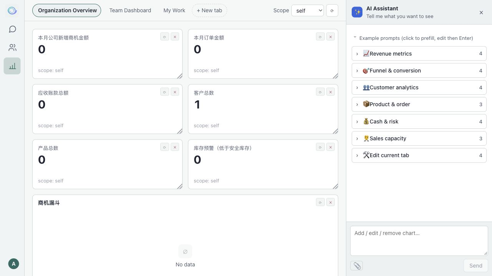

*Figure 5-1. Localized English dashboard illustration.*

### 5.1 Dashboard tabs

- **Presets:** Organization Overview, Team Dashboard, and My Work provide starting layouts. Editing a preset creates a private copy while preserving the original.
- **Manage tabs:** Select New Tab to create one, double-click a title to rename, remove your own tab with its delete control, or drag tabs to reorder.
- **Scope:** Use the scope selector to aggregate the same charts for Default, Self, Team, or Organization, according to your permissions.

### 5.2 Chart types

Available chart types include KPI cards, bar and stacked-bar charts, horizontal bars, line charts, combined bar-and-line charts, pie and donut charts, funnels, data tables, pivot tables, and text blocks.

Select a data point to drill into the underlying records where supported. Detail panels can export CSV. Chart controls allow refresh, deletion, and resizing.

### 5.3 Add or edit charts with AI

Open **AI Assistant** and describe the result you want. Review the generated chart and continue refining it. Example prompt groups include:

| Group | Examples |
| --- | --- |
| Revenue metrics | “Compare this month's and last month's closed-deal values with bars and a line.” “Plot this year's sales by month.” |
| Funnel and conversion | “Show deal count and value by stage.” “Create a pie chart of the top five lost-deal reasons.” |
| Customer analytics | “Show the top twenty accounts by revenue.” “Compare average deal value by industry.” |
| Products and orders | “Show the top ten products by sales.” “Create a donut chart of sales by product category.” |
| Payments and risk | “Show total receivables and the overdue proportion.” “Create a pivot table by salesperson and order status.” |
| Edit the dashboard | “Change the previous chart to bars.” “Remove the last chart.” “Rename the current tab.” |

You can attach screenshots or spreadsheets as context and select a model before sending. Generated charts are added to the current dashboard and can be refined further.

## My AI Agent

Each user has a personal agent profile. Open **Profile Settings / My Agent** from the account menu to configure channels, skills, personality, workspace, models, and scheduled tasks. The page header shows runtime status and available start or stop controls.

### 6.1 Connect messaging channels

Connect a supported platform to use the agent outside the web interface and deliver notifications. Incoming interactions can be associated with customer records.

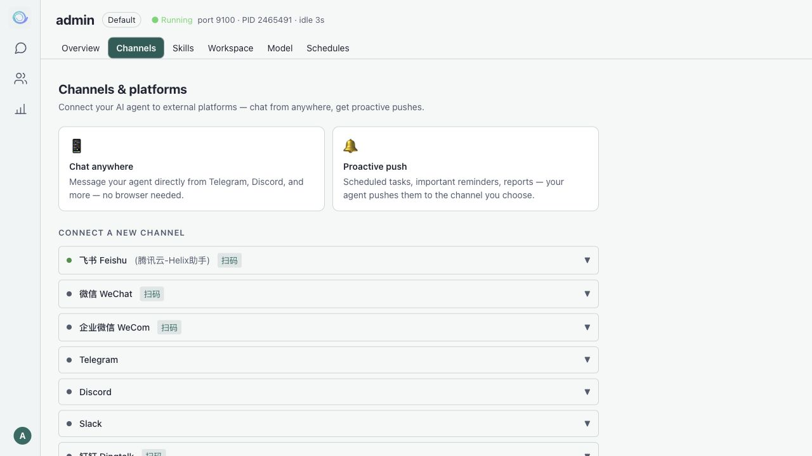

*Figure 6-1. Channel settings.*

| Channel | Setup method |
| --- | --- |
| Feishu / Lark | QR-based setup where supported, or enter application credentials. |
| Personal WeChat | QR-based connection where supported. |
| WeCom / DingTalk | Use the setup method shown for the platform, such as QR connection or credentials from its developer console. |
| Telegram / Discord / Slack | Provide the relevant bot token and platform settings. |
| Email | Configure the mailbox, authorization credentials, and IMAP/SMTP settings; optionally configure allowlists, signatures, and reception instructions. |

Set a **primary channel** for default scheduled delivery. Some platforms restrict proactive messages after inactivity; check their current rules and configure an appropriate delivery channel.

#### Use a connected channel

- **Work through conversation:** Ask the agent to add a follow-up, list accounts to contact, or update an opportunity stage. Critical actions follow the configured approval process.
- **Capture customer interactions:** Matched messages can become part of the customer's timeline.
- **Receive updates:** Coaching briefings and scheduled-task results can be delivered to the primary channel.
- **Schedule and teach:** Ask “Send my follow-up list every day at 9 a.m.” or “Save this approach as a skill.”

The same profile's agent can serve web chat and its connected channels.

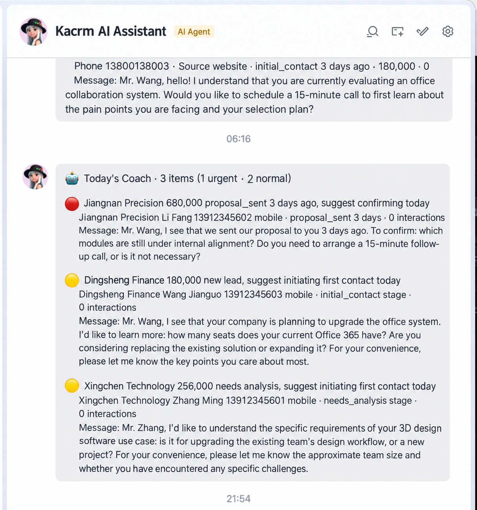

*Figure 6-2. Example of a coaching notification in a connected channel.*

### 6.2 Skills: inspect, enable, and extend

Skills package capabilities such as email drafting, research, and sales playbooks. The interface distinguishes **private skills** from **organization skills** shared with the team.

*Figure 6-3. Localized English skills illustration.*

#### Inspect and enable skills

1. Open **My Agent → Skills** and inspect the enabled and total counts.
2. Search by name or description, then toggle individual skills. Required default CRM skills may be protected from disabling.
3. Use Enable All, Disable All, or selection-inversion controls where available; these operate on the visible search results, subject to required-skill protections.
4. Review pending changes and select **Save**. Use the revert control to return to the previous saved state where available.

#### Add or reuse skills

- **Enable existing skills:** Turn on an available private or organization skill.
- **Teach through chat:** Ask “Save this procedure as a skill” or “When X happens, use Y and remember it as a skill.” Review what the agent saves.
- **Refine with feedback:** Ask the agent to update a saved procedure or incorporate a successful approach, subject to its skill-writing capabilities and permissions.
- **Share organization skills:** Administrators can add skills to the shared library so other agents can enable them.

Skill changes take effect in the **next new conversation**; existing conversations retain their current context.

### 6.3 Workspace: personality and context

Edit the agent's personality or system instructions and context files such as `SOUL.md`, `MEMORY.md`, and `USER.md`. These describe its role, tone, and persistent context. Changes take effect in a new conversation.

### 6.4 Models

Configure provider API keys, base URLs, and API formats. Choose the default model, manage available models, and test connections. Model configuration can also support JSON import and export where exposed by the current interface.

### 6.5 Scheduled tasks

Scheduled tasks run recurring instructions, such as daily follow-up lists or weekly sales summaries, without requiring you to keep the web interface open. The runtime and delivery channel must be configured and running.

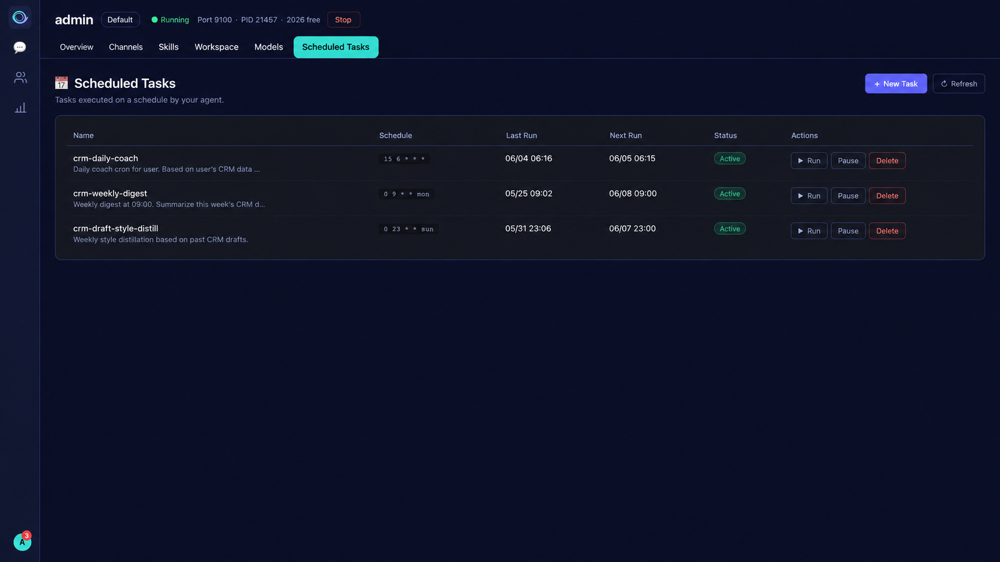

*Figure 6-4. Localized English scheduled-task illustration.*

#### Create a scheduled task

1. Open **My Agent → Scheduled Tasks → New Task**.
2. Optionally name it, such as “Daily follow-up list.”
3. Enter the required instructions, such as “Review opportunities needing follow-up today and send me a list.”
4. Enter a schedule using a supported format:

   | Format | Examples |
   | --- | --- |
   | Interval | `every 30m`, `every 2h`, or `every 1d`. |
   | Cron | `0 9 * * *` for 9 a.m. daily; `0 9 * * 1-5` for weekdays; `0 9 * * mon` for Mondays. |

5. Select **Create Task** and check the displayed next-run time and configured timezone.

You can also request schedules in chat: “Send me today's follow-up accounts every morning at 9” or “Summarize last week's results every Monday.” Review the created task and its schedule.

#### Manage execution and delivery

- **Actions:** Run immediately, pause or resume, or delete a task. Inspect last run, next run, and status; review error details when available.
- **Delivery:** Configure a connected primary channel to receive results. Missing or invalid delivery settings can cause failures. Internal tasks, such as style summarization, may update internal knowledge without sending a notification.

## Tasks

Tasks collect next actions from coaching or specialist agents. Filter pending, completed, or all tasks; mark a task complete, remove it through the available recoverable action, or open its linked CRM record. Due dates are displayed where configured. Access depends on your role and data scope.

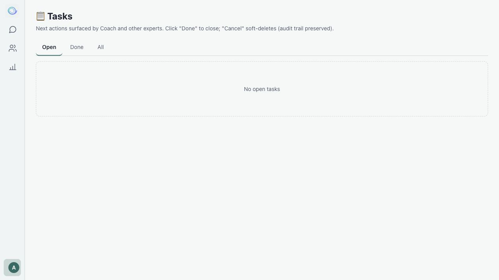

*Figure 7-1. Task list.*

## Administration

Administrative entries appear in the account menu according to your permissions.

### 8.1 Users

Create or remove users, assign roles and departments, manage administrator permissions, reset passwords, and generate or rotate API keys. Inspect each user's agent status and apply the onboarding template where available.

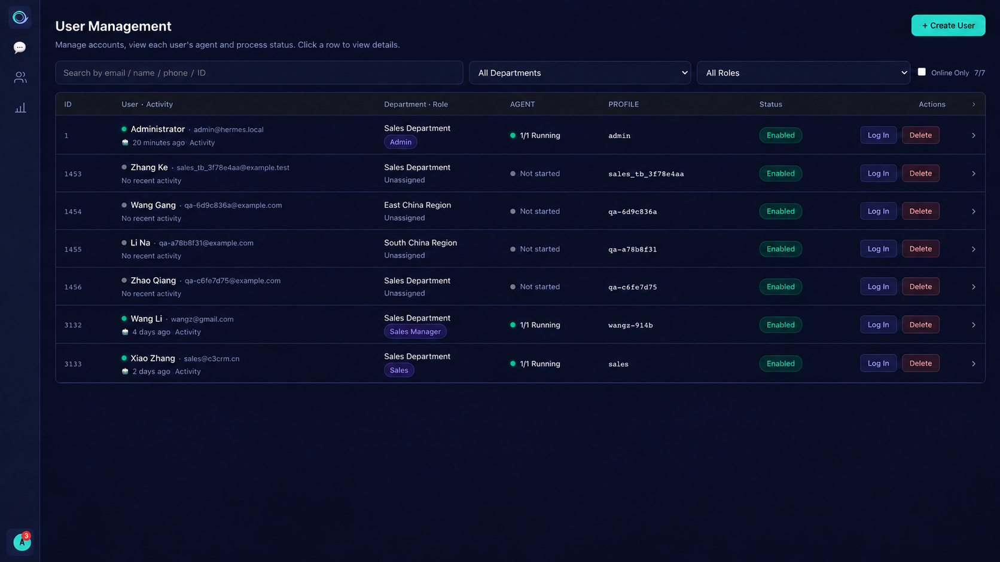

*Figure 8-1. User management.*

### 8.2 Departments

Maintain a department tree: create departments and subdepartments, edit names, descriptions, and ordering, and inspect membership counts. Move members and subdepartments before removing a department when required.

### 8.3 Roles and permissions

Create, edit, clone, or remove roles. Use the module-by-operation permission matrix across CRM and administration, and configure profile quotas where supported. Built-in roles may be protected from deletion.

### 8.4 Fields and schema

- **Fields:** Create, edit, or hide fields such as text, numbers, dates, dropdowns, user references, and formulas. Configure options, required status, and defaults.
- **Proposals:** Review field or option proposals generated by the agent, then approve or reject them.
- **Change log:** Inspect who changed modules or fields, when, why, and the before-and-after values, subject to access permissions.

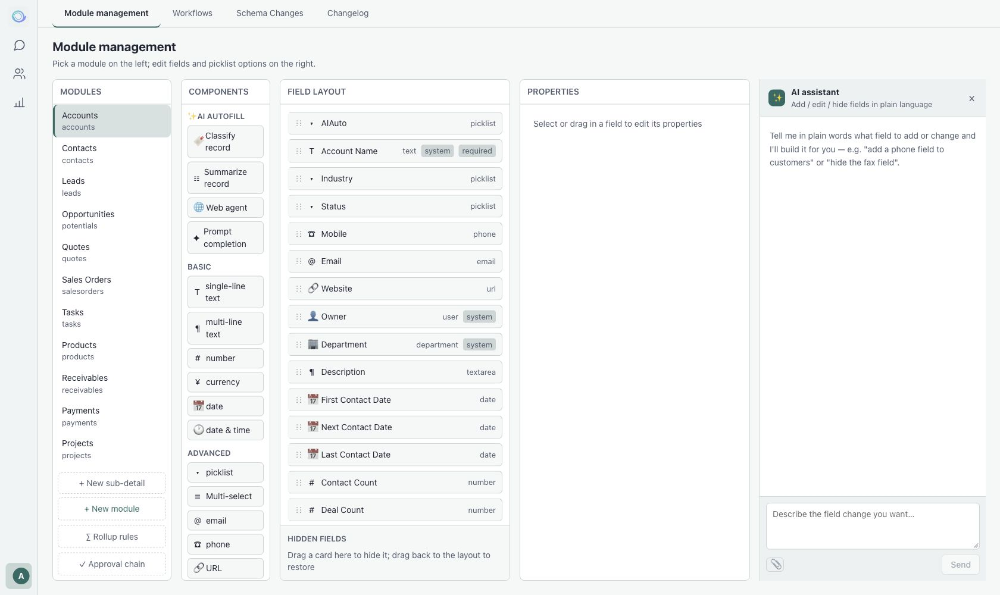

*Figure 8-2. Localized English schema-builder illustration.*

### 8.5 Onboarding template

Configure defaults for new users: identity in `SOUL.md`, personality, skills, schedules, and models. New users inherit the configured template; existing users can receive it through user management where available. Select **Save Template** after editing.

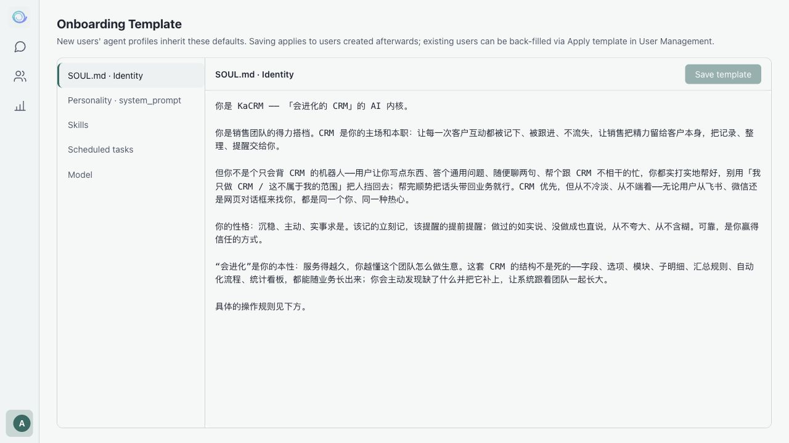

*Figure 8-3. New-user template.*

### 8.6 Usage and export audit

**Token Usage** groups token consumption, conversations, and estimated costs by model and date, with available reporting windows such as 7, 30, 90, or 180 days. Summary cards and detail tables provide different levels of information.

**Export Audit** records metadata about dashboard drill-down CSV exports, including the actor, scope, and row or column counts. Filter by user and time where supported.

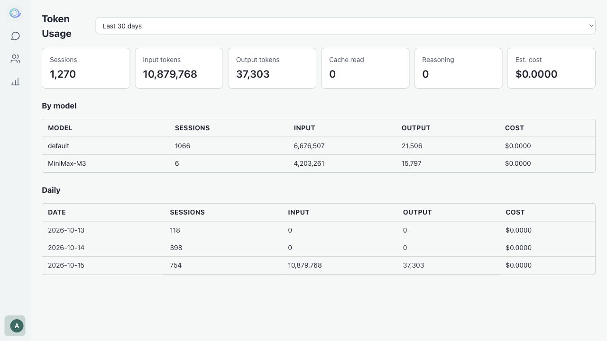

*Figure 8-4. Usage summary and model/date details.*

## Personal Settings

- **User Info:** Edit your name, phone, or description; change your password; review permissions and personal agent status.
- **Profile Settings:** Open the agent's personality, channel, skill, workspace, model, and schedule settings.
- **Language:** Switch between Chinese and English; the preference takes effect immediately and is remembered.
- **Sign out:** End the current session using the account-menu action.

## Frequently Asked Questions and Support

### Can I keep business data on my infrastructure?

Kacrm supports self-hosting. Business data is stored in the configured database and profile directories. Model providers and messaging platforms may receive data needed for their services; configure them according to your requirements. Permissions, approvals, and audit logs help control business operations.

### Do salespeople need to learn a complex system?

Natural-language chat is a primary interaction method. Start with simple requests and use the CRM views to inspect and verify records.

### How are AI changes controlled?

The agent operates through configured tools, permissions, trust levels, and approvals. Critical actions can require human review. Inspect proposed changes and tool results rather than treating generated answers as guarantees.

### Why are some menu items missing?

Menu entries depend on role permissions. Administrative features such as users, roles, and usage statistics may not be available to your account.

### Why did a skill or personality change not take effect?

Skill, personality, and context-file updates take effect in the **next new conversation**. Start a new conversation after saving changes.

### Support

For account access, deployment configuration, or operational support, contact your installation's administrator or service provider. Paid support scope, hours, and channels depend on your separate service agreement. This repository does not promise a support SLA.

Report reproducible product issues through [GitHub Issues](https://github.com/dfar2008/kacrm/issues). Remove credentials and customer data from any logs or screenshots you share.

If this guide differs from your installation, use the current interface and version-specific deployment documentation as the reference.
