# KaCRM 使用指南

[English](user-guide.en.md) · **简体中文**

本 Markdown 文档为使用指南的主要维护版本，可在 GitHub 直接阅读。[HTML 打印版](user-guide.html) 保留当前排版快照，供浏览器打印或另存为 PDF。后续内容更新以本文件为准。

本文仅描述当前源码部署的使用方式。模型调用、外部渠道、技能写入、定时投递和审批行为取决于所配置的服务、工具及权限；示例图和演示对话不代表当前部署已通过验收。

## 目录

- [产品简介与核心理念](#产品简介与核心理念)
- [快速开始与界面总览](#快速开始与界面总览)
- [对话工作台(首页)](#对话工作台首页)
- [客户与 CRM](#客户与-crm)
- [数据看板](#数据看板)
- [我的 AI Agent](#我的-ai-agent)
- [任务](#任务)
- [系统管理](#系统管理)
- [个人设置](#个人设置)
- [常见问题与支持](#常见问题与支持)

本指南截图于 2026-10-15 使用 Codex 内置浏览器从当前 KaCRM 界面采集，覆盖桌面、手机、浅色和深色；中英文界面分别实拍。架构图由仓库中的 HTML 源文件渲染。图片中的数据仅用于说明界面，不代表业务成效或渠道投递成功，来源与页面清单见[截图说明](../assets/user-guide/SOURCES.md)。部署与升级请参阅仓库的部署文档；本仓库不附带界面导览视频。

## 产品简介与核心理念

KaCRM 是一款**会进化的对话式 AI CRM**。传统 CRM 为「管理层填报」设计,要求销售把客户关系压缩进冰冷字段;KaCRM 反过来为「销售成交」设计——每位销售拥有专属智能体,用自然语言即可完成记录、跟进与商机管理,在已配置的渠道、工具权限和定时任务范围内，将沟通关联到客户记录，并提供跟进提醒。

### 五大根本转变

| 能力 | 说明 |
| --- | --- |
| ① 对话即数据 | 通过对话提炼客户要点并调用 CRM 工具更新记录，结果需核对 |
| ② 全渠道统一 | 已连接渠道的消息在匹配到记录后可汇入客户时间线 |
| ③ AI 驱动·人监督 | 通过权限、信任等级与审批策略控制自动执行及人工复核 |
| ④ 越用越懂你 | 复用话术画像和销售方法论，根据反馈请求更新字段与技能 |
| ⑤ 它会自己上班 | 配置并运行定时任务后，可通过已连接的主渠道投递跟进清单 |

图 1-1　KaCRM 产品架构:触点层 → AI Agent 核心 → CRM 数据资产 → 洞察与教练

## 快速开始与界面总览

### 2.1 登录

1. 打开 KaCRM 访问地址,进入登录页。
2. 输入管理员分配的**邮箱 / 用户名**与**密码**,点击「登录」。
3. 首次登录后,系统自动为你创建专属的 AI 工作档案(Profile)。

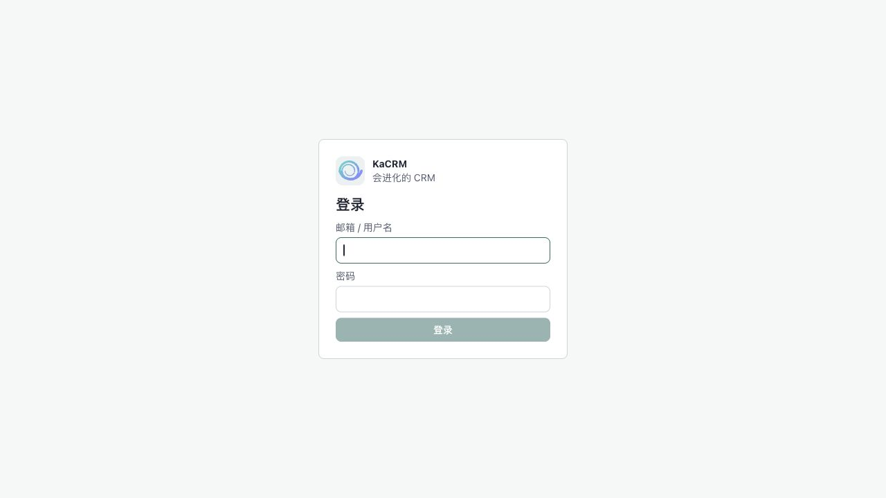

图 2-1　登录页

账号由管理员在「用户管理」中创建并分配角色权限;忘记密码请联系管理员重置。界面右下角账号菜单可随时**切换中文 / English**。

### 2.2 首次设置向导(3 步)

首次登录后,系统会自动带你进入**「先完成 3 步设置」向导**(也可随时访问 `/app/setup`)。配好后即可在网页和聊天软件里与你的 Agent 对话。

向导页顶部有**三个标签**:**「快速设置」**(默认,即下方三步)、**「对话演示」**、**「CRM 界面导览」**——先在「快速设置」配好,再随时点另两个标签看 KaCRM 怎么用。

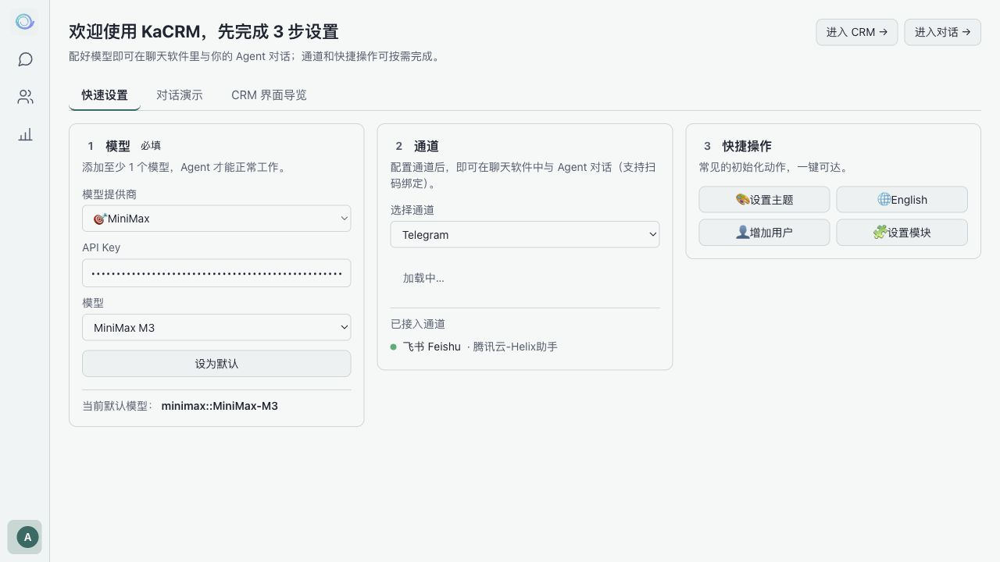

图 2-2　首次设置向导「快速设置」标签:① 模型 ② 通道 ③ 快捷操作(顶部可切「对话演示 / CRM 界面导览」)

| 步骤 | 做什么 |
| --- | --- |
| **① 模型**(必填) | 选模型供应商(DeepSeek / MiniMax / OpenAI 等)→ 填 API Key → 选具体模型 → 点「设为默认」。至少配 1 个模型,Agent 才能工作。 |
| **② 通道** | 选渠道(飞书 / 微信 / 企业微信 / 钉钉 / 邮件…)并连接(飞书 / 微信支持扫码)。接好后即可在聊天软件里直接和 Agent 对话。 |
| **③ 快捷操作** | 常见的初始化动作一键可达:设置主题 / 切换语言 / 增加用户 / 设置模块(详见下表)。 |

技能无需在向导里配置——**系统默认的 CRM 技能开箱即已启用**;要增配或管理其他技能,请到「我的 Agent → 技能」(系统默认的 CRM 技能不可移除)。

**③ 快捷操作**的四个按钮:

| 按钮 | 作用 |
| --- | --- |
| 🎨 设置主题 | 当场弹出主题选择,改完立即生效。 |
| 🌐 切换语言 | 一键中文 ↔ English(按钮上显示的就是要切换到的语言)。 |
| 👤 增加用户 | 直达「用户管理」新增成员(需用户管理权限)。 |
| 🧩 设置模块 | 直达「模块管理」定制模块与字段,页内也可直接和 AI 助手对话定制(需管理权限)。 |

后两项是管理操作:**没有相应权限时按钮自动隐藏**,普通成员通常只看到「设置主题」和「切换语言」。

页头右上角:「**进入对话 →**」可随时跳过向导直接开始;有 CRM 权限的用户还会看到「**进入 CRM →**」,一键直达客户管理主界面。通道也能稍后在「我的 Agent」里补。

**「对话演示」标签**——自动播放的模拟对话导览,8 步讲完 KaCRM 的核心用法:

| 步骤 | 演示内容 |
| --- | --- |
| ① 线索转化 | 「新增线索:杭州云帆科技、张总,对私有化方案有意向,帮我转成客户和商机」——一句话走完销售漏斗入口:线索 → 客户 + 联系人 + 商机。 |
| ② 长出字段 | 说一句「加个行业下拉」,新字段当场长在客户档案上,所有记录即刻可用。 |
| ③ AI 字段 | 「加个公司背景,AI 联网调研自动填」——看得到它联网搜索,填完带**置信度圆点**和**来源引用**。 |
| ④ 长出模块 | 「建个费用报销模块」,左侧菜单当场长出新模块。 |
| ⑤ 拍图录入 | 上传一张**发票照片**说「帮我记一笔报销」——AI **读图识别**金额 / 类别 / 开票日 / 供应商,落成一条费用报销待你核对（核对识别结果，不确定的字段需人工确认）。 |
| ⑥ 自动化 | 「成交超 100 万自动建高优跟进」,工作流即建即用;对外 / 关键动作遵循已配置的审批策略。 |
| ⑦ 看板 | 「按月画个销售额柱状图」,图表直接进看板。 |
| ⑧ 主动晨报 | 第二天清晨没人提问,Agent 主动推送待跟进清单(飞书 07:30)——它会自己上班。 |

演示顶部有 **8 个章节圆点**,点哪一步就跳到哪一步,也可随时「暂停 / 重播」;看完点「进入对话试试 →」即可亲手体验。

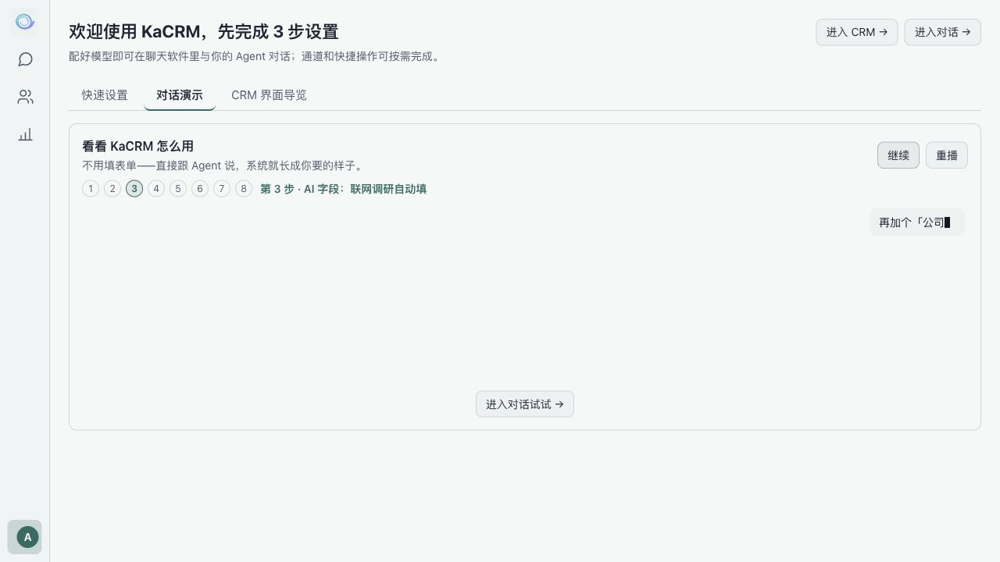

图 2-3　「对话演示」八步导览(图为第 3 步:AI 字段联网调研自动填,含置信度与来源)

**「CRM 界面导览」标签**——一段约两分半的**真实操作录屏**(带中英章节字幕,随界面语言切换),让你在动手前先看到:对话之外,KaCRM 还有一整套顺手的管理界面。八个章节依次演示:

| 章节 | 演示内容 |
| --- | --- |
| ① 客户列表 | 搜索、业务分段、我的 / 团队 / 全部数据范围切换。 |
| ② 列表字段 | 搜索框旁 ⚙ 打开定制器:两行布局,想看什么字段自己放。 |
| ③ 五种视图 | 同一份数据在表格 / 卡片 / **看板(拖卡片换阶段)** / 时间线 / 日历间秒切,可保存命名的自定义视图。 |
| ④ 摘要芯片 | 记录详情顶部的关键字段芯片,管理员点 ⚙ 自定义展示哪些。 |
| ⑤ 全部信息 | 抽屉里全字段一屏尽览:1/2 列网格切换、**点击即改**、字段旁 🤖 一键让 Copilot 改。 |
| ⑥ 面板宽度 | 列表 / 详情 / Copilot 三栏宽度随手拖,双击手柄复位,按模块记住。 |
| ⑦ 记录 Copilot | 每条记录自带 AI:自动摘要 + 建议提问,选好模型一句话驱动 CRM。 |
| ⑧ 审批中心 | Agent 的关键动作先送审批,「批准 / 拒绝」一键拍板——AI 干活,人拍板。 |

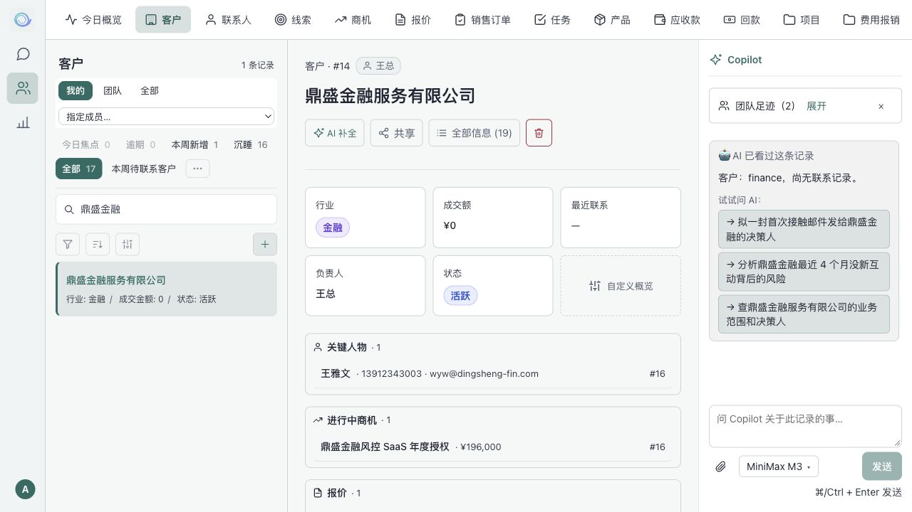

图 2-4　当前客户列表与详情实拍。界面导览录屏不随本仓库分发；以上图片展示当前页面，而非旧录屏截帧。

### 2.3 快速导航 —— 怎么找到每个功能

登录后,界面**最左侧是一条导航栏**。它分两部分:上方三个**主模块图标**,底部一个**账号头像**——点头像会弹出**账号菜单**,系统的其余功能入口都在这里(菜单项按你的权限自动显示/隐藏)。

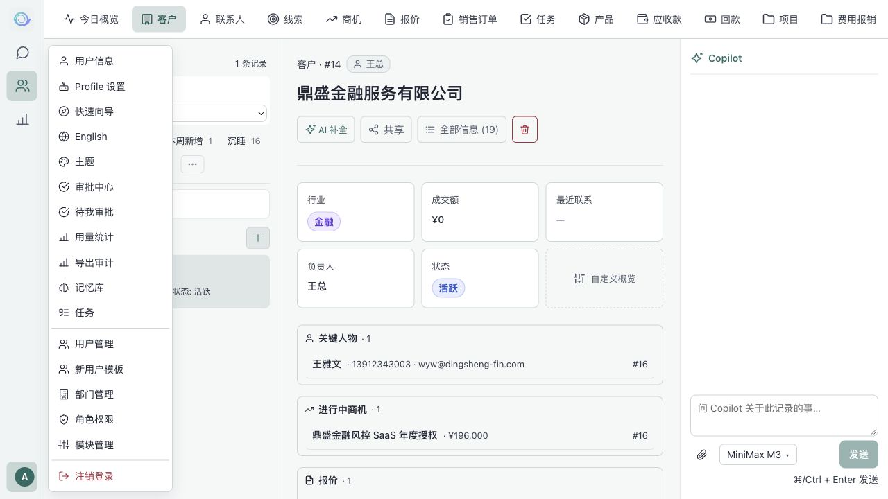

图 2-5　左侧导航栏(主模块)+ 点头像弹出的账号菜单(全部功能入口)

| 位置 | 入口 |
| --- | --- |
| 导航栏 · 主模块 | 💬 **聊天**(AI 助手 + 今日工作台)、👥 **CRM**(线索/客户/商机/订单…)、📊 **统计**(数据看板 + AI 自助分析) |
| 账号菜单 · 个人 | 用户信息、Profile 设置(我的 Agent)、中英文切换、注销登录 |
| 账号菜单 · 工作 | 待我审批、审批中心、待认领消息、记忆库、任务 |
| 账号菜单 · 管理(管理员) | 用户管理、部门管理、角色权限、字段与 Schema、新用户模板、用量统计、导出审计 |

导航栏顶部的 KaCRM 图标显示你的 Agent 进程状态:**绿点**=运行正常,**红点**=未运行(点击进入设置)。

### 2.4 不会用?直接问 AI(内置使用助手)

KaCRM 内置了**「使用助手」**——遇到任何"怎么用 / 在哪里 / 为什么"的问题,**不用翻手册,直接问 AI 即可**。在网页「对话」里,或在你已接入的**飞书 / 微信**等渠道里,直接发问:

- 「怎么在看板上加一个图表?」
- 「飞书怎么接进来?」
- 「改了技能为什么没生效?」

AI 会即时给出操作步骤。可以把它理解成**这份指南的"活版本"**:随产品更新、随时可问、所有渠道通用。

而且它会**自我成长**:遇到手册暂时没覆盖的问题,它会查证后把通用答案沉淀进自己的知识里——**问的人越多、它越全**,和 KaCRM 的技能一样越用越懂。

## 对话工作台(首页)

「对话」是你与 AI 助手协作的主场。用自然语言告诉它要做什么,它会完成对应的 CRM 操作并把完整对话留档;首页还汇集了 AI 为你准备的「今日该做什么」。

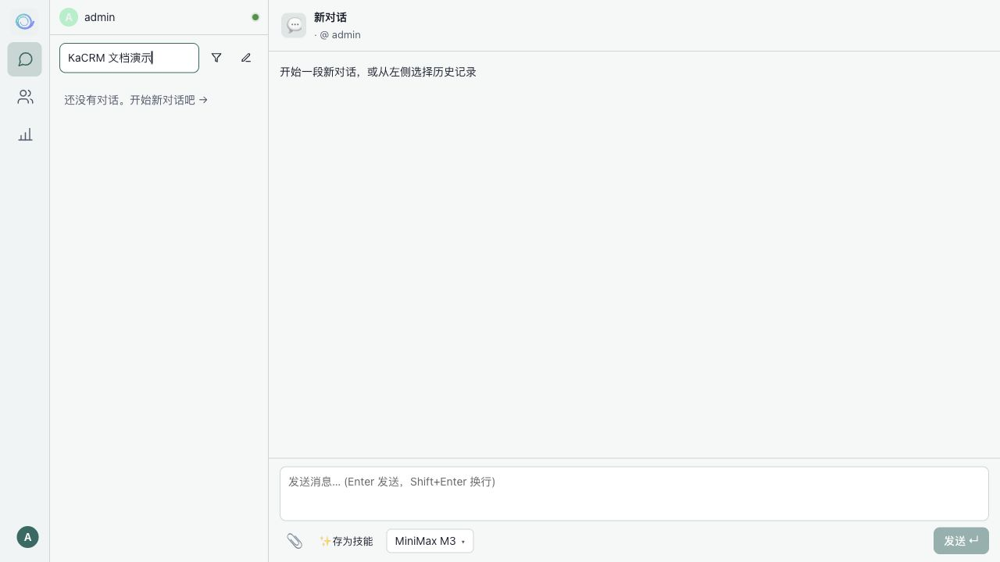

图 3-1　对话工作台

### 3.1 会话管理

- **新建对话**:左上角「✎ 新建对话」按钮,清空当前开始新会话。
- **历史会话列表**:左侧按时间分组(今天 / 昨天 / 更早),显示渠道来源图标、标题与预览。
- **搜索与归档**:顶部搜索框按标题 / 内容实时筛选;漏斗按钮在「聊天 / 已归档」间切换。
- **会话操作**:悬停某条会话出现「⋮」菜单,可**归档 / 恢复 / 删除**。

### 3.2 对话与 AI 操作

- **发送消息**:底部输入框输入,Enter 发送、Shift+Enter 换行;发送前可在「模型选择器」切换大模型。
- **流式回复**:AI 回复逐字出现;过程中按钮变为「停止」可中断。
- **发文件 / 图片**:输入框左下「📎 上传图片 / 文档」可带图片、PDF、Excel、Word、CSV、TXT;选好后显示为可删除小卡片,随消息一起发,AI 能读图 / 读文件并把附件**关联到对应记录**。
- **联网调研**:可直接让 AI「查一下 XX 公司的工商 / 财务信息」「搜一下 XX 的最新消息」,在联网工具可用时可进行检索并提供来源；请核对引用与结论，不将生成内容作为真实性保证。
- **工具调用展示**:AI 调用工具(查询、写库等)时以可折叠卡片展示工具名、状态(进行中 / 完成 / 失败)、输入与输出。

### 3.3 今日工作台

首页用标签页汇总三类「今天该做的事」,空标签自动隐藏:

- **🚨 今天最该处理**:AI 综合教练提示、互动沉默、逾期日期等智能排序的 TOP 记录;#1 红、#2 橙标注紧迫度,点击整行直达记录并预填 Copilot。
- **📋 今日 Coach**:AI 已起草好的跟进话术,一键复制即可发给客户。
- **🎯 决策提示**:动词开头的建议,点击即预填到 AI 输入框。

### 3.4 每周 AI 报告

当无进行中的会话时,首页中央显示上周 AI 替你完成的工作总结(成交 N 单、推进 M 单、新增线索等),并附最多 3 条教练提示,点击可直达对应记录。

## 客户与 CRM

「客户(CRM)」提供完整的销售业务模块。所有沟通与操作都汇入统一的**互动时间线**,字段与视图可按企业需要配置。

「今日概览」集中展示销售进展、优先跟进事项和 AI 动作。先在概览安排工作，再进入模块查看列表与记录详情。

图 4-1　CRM 记录 · 互动时间线 + Copilot 侧栏

### 4.1 业务模块

| 模块组 | 包含 |
| --- | --- |
| 客户主数据 | 线索 · 客户 · 联系人 |
| 交易流程 | 商机 · 报价 · 销售订单 |
| 执行与回款 | 任务 · 应收款 · 回款 · 产品 |

顶部「今日概览」入口可返回销售工作概览，页面中的互动区展示权限范围内的活动。

### 4.2 记录列表

- **搜索 / 分段筛选**:按名称、备注搜索,或用业务分段快速查看。
- **数据范围**:在「我的 / 团队 / 全部」之间切换(团队、全部需相应权限);管理员可指定具体成员。
- **列表信息**:每行显示记录名、模块特定指标(商机金额 / 阶段、任务优先级 / 截止、报价订单金额等)、联系次数、最近联系、下次联系(逾期标红)。
- **快速撤销**:最近修改 120 秒内出现「↶ 刚改」标签,一键撤销。
- **列表视图**:除默认表格外,同一模块还能切**卡片 / 看板(Kanban,按状态列拖拽)/ 时间线 / 日历**视图;在列表上方视图栏切换,视图由「自定义视图」按名称保存。
- **新建记录**:「+」按钮打开分组表单，必填字段带星号，支持文本、日期、小数金额、下拉、用户及关联选择。数字字段直接填写数值，例如 `12.75`；底部「创建」提交，「取消」关闭。

### 4.3 记录详情

- **业务摘要**:标题区下方以卡片展示阶段、金额、日期、负责人等关键字段；管理员可通过「自定义概览」配置展示内容。
- **全部信息抽屉**:点「全部信息」展开所有字段,点击即改;支持 1 列 / 2 列切换,每个字段旁的「🤖」可让 Copilot 用自然语言改值。
- **互动时间线**:倒序展示邮件 / 电话 / 会议 / 消息 / 笔记 / 系统操作等全部事件;系统操作可「查看原始事件」审计、120 秒内可撤销。
- **手工记一笔**:快速记录联系内容、进展与下次联系日期,自动并入时间线。
- **产品明细**:报价 / 订单可编辑产品行(数量、单价、折扣、税率),自动算小计与总额。
- **回款联动与恢复**:回款新增、金额编辑、更换应收关联或删除后，相关应收的实付额、余额、状态及订单汇总同步更新。自己删除的回款可在 120 秒内通过页面提示「恢复回款」还原，恢复后仍为原记录。
- **记录共享**:所有者 / 管理员可「🔗 共享」给同事,分别授予可查看 / 可编辑。
- **AI 记忆面板**:显示 AI 从往来中自动记住的事实与关联人物,可跳转记忆库。

### 4.4 记录级 AI(Copilot 与 AI 焦点)

- **记录 AI 分析卡**:打开记录时,Copilot 顶部自动给出一句话摘要 + 注意事项 + 3 条建议提问,点击即问。
- **AI 焦点**:记录顶部显示 AI 发现的风险 / 异常提示,可「让 AI 处理」「已读」「忽略」。
- **Copilot 侧栏**:就当前记录对话,可让 AI 改字段、加笔记、查信息;写入遵循配置的权限与审批策略。
- **关联实体**(客户):一屏看该客户下的联系人、进行中商机、跟进任务、报价、订单、应收款。

### 4.5 团队视角(管理者)

部门负责人 / 管理员在 CRM 中可额外获得团队视角:

- **团队晨报**:每日总结团队前 24 小时的 Agent 动作、成员接受度与沉睡商机预警,可推送到飞书 / 企业微信。
- **团队足迹**:打开某客户 / 联系人时,显示该记录是否被团队其他成员触及过、最后接触者与时间——接手离职同事客户时尤其有用。
- **团队看板**:AI 行为日历(本周通过 / 撤销 / 等待)、团队沉睡商机趋势、Pipeline 漏斗等团队指标。

### 4.6 待认领消息

入口在**账号菜单 → 待认领消息**。飞书 / 微信 / 企业微信 / 钉钉 / 邮件等渠道进来的消息,若**没能自动匹配到 CRM 记录**,会归集到这里、按发件方聚合。处理:点某条 →「**认领到记录**」→ 选模块(联系人 / 客户 / 线索)→ 搜或填记录 → 确认绑定;绑定后该消息及后续往来自动并入那条记录的**互动时间线**。适合把陌生新联系人 / 客户的首次来信归位。

## 数据看板

看板提供实时业务图表,并支持用自然语言让 AI 自助生成 / 修改图表——无需学习复杂的报表配置。

图 5-1　数据看板 + AI 助手自助加图表

### 5.1 看板标签页

- **系统预置看板**:如「组织全景 / 团队看板 / 我的工作」,开箱即用。任何编辑会自动复制成你的私有副本,原版不变。
- **新建 / 重命名 / 删除 / 排序**:点「+ 新 tab」新建;双击标题重命名;「×」删除自建 tab;拖拽调整顺序。
- **作用域(Scope)**:顶部下拉在 默认 / 个人 / 团队 / 组织 间切换,同一套图按不同范围聚合。

### 5.2 图表类型

指标卡、柱状图、堆叠柱状图、横向条形图、折线图、柱线复合图（双轴）、饼图、环形图、漏斗图、数据表格、透视表与文本块。

点击任意图表的数据点可**钻取**查看明细,明细面板支持导出 CSV。鼠标悬停图表卡片可**刷新 / 删除 / 调整大小**。

### 5.3 用 AI 助手加 / 改图表

点右上「✨ AI 助手」,用自然语言描述需求,AI 当场生成并加入看板。内置丰富示例提示词分组:

| 分组 | 示例提示词 |
| --- | --- |
| 业绩指标 | 「用柱+线复合图对比本月和上月的成交金额」「今年累计成交金额按月折线」 |
| 漏斗与转化 | 「商机漏斗按阶段 count + 金额」「丢单原因 Top 5 饼图」 |
| 客户分析 | 「客户金额贡献 Top 20」「客户行业平均成交金额」 |
| 产品与订单 | 「产品销售额 Top 10」「产品分类金额贡献环形图」 |
| 回款与风险 | 「应收账款总额 + 逾期占比」「销售员 × 订单状态透视表」 |
| 编辑当前看板 | 「把上一个图改成柱状图」「删掉最后一个图」「重命名当前 tab」 |

AI 助手支持上传截图 / 表格作为参考;发送前可选择大模型。生成的图表自动加入当前看板,可继续追加调整。

## 我的 AI Agent

每位用户拥有一个专属 AI Agent。在账号菜单进入「我的 Agent」可配置它的渠道、技能、人设、模型与定时任务。页面顶部可启动 / 停止 Agent 进程并查看运行状态。

### 6.1 渠道接入与使用

把 Agent 连接到客户日常使用的平台,消息自动归入客户档案,并可主动推送通知。

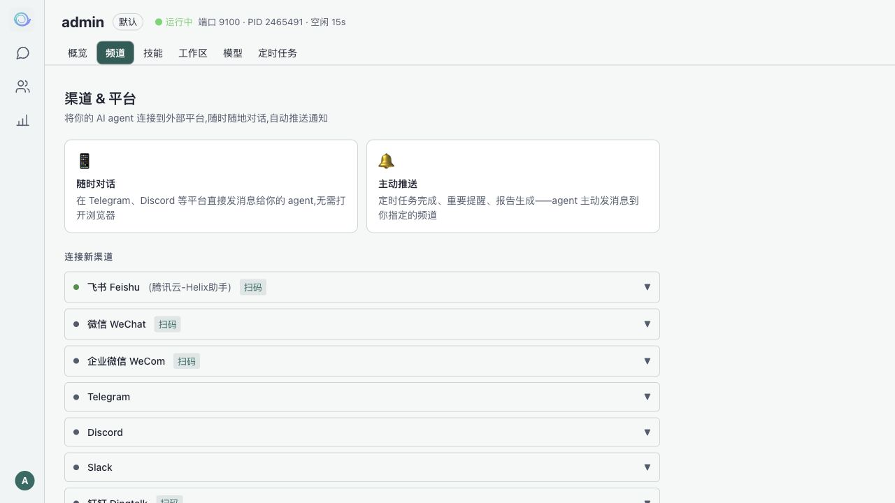

图 6-1　渠道 & 平台

| 渠道 | 接入方式 |
| --- | --- |
| 飞书 / Lark | **扫码**一键连接(自动建 PersonalAgent 应用),或手动填 App ID / Secret |
| 微信(个人) | **扫码**连接 |
| 企业微信 / 钉钉 | **扫码**一键连接(推荐),或在对应开放后台获取 Corp/App Key + Secret 后手填 |
| Telegram / Discord / Slack | 填写 Bot Token 等凭证 |
| 邮件 | 填邮箱 + 授权码 + IMAP/SMTP;可设白名单、落款、客户接待话术等 |

可将某渠道设为「主渠道」作为定时推送默认投递地址。微信若长时间无对话,清晨推送可能被平台拦截,建议同时绑定飞书或每天主动发一条消息保活。

#### 接入后怎么用(重点)

接通后,这个渠道就成了你的「随身 KaCRM」—— 不打开网页也能干活:

- **直接对话办事**:在飞书 / 微信里像聊天一样发指令,如「给腾讯这条商机加条跟进」「本周该跟进哪些客户」「把江南精密阶段改成方案确认」,Agent 当场完成对应 CRM 操作并回复你(关键操作遵循配置的审批策略)。
- **客户消息自动归档**:客户在该渠道找你,往来对话自动沉淀进对应客户档案、汇入互动时间线,不用手动记。
- **主动推送**:每日 Coach 跟进清单、定时任务结果会主动推到你设的主渠道(见 6.5)。
- **顺手安排 / 教学**:直接说「每天 9 点发我跟进清单」即可建定时任务;说「把这个做法记成技能」它会沉淀成新技能(见 6.2 / 6.5)。

同一个 Agent 贯通网页对话、飞书、微信等所有渠道——在哪个渠道说都一样懂你、一样能办事。

连接与投递状态请以当前「频道」页面及目标平台的实际消息为准。旧版飞书聊天配图已移除，避免将历史推送内容误认为当前部署的结果；配置入口见图 6-1。

### 6.2 技能 —— 查看、增减与演化

技能是 Agent 在对话中可调用的能力(写邮件、查资料、各类销售方法论等)。分两类:**🧠 私有技能**(Agent 自学、专属于你)与 **🏢 组织技能**(来自组织共享库)。

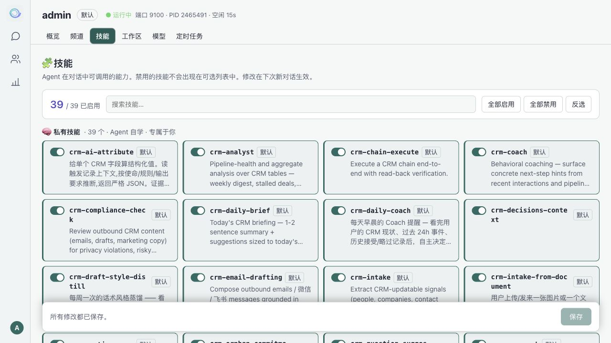

图 6-3　技能管理:开关 / 搜索 / 批量启用

#### 查看与开关(操作步骤)

1. 账号菜单 → **我的 Agent** → 「**技能**」标签;顶部显示「已启用 / 总数」(如 93 / 122)。
2. 用搜索框按名称或描述过滤;点技能卡片的开关**启用 / 禁用**单个技能。**系统默认的 CRM 技能(带「默认」标记)不可禁用**——它们是产品核心能力,只可增配其他技能。
3. 批量:「**全部启用**」「**全部禁用**」「**反选**」(作用于当前搜索结果;默认 CRM 技能不受禁用影响)。
4. 底部显示待保存数量,点「**保存**」生效,点「撤销」回到上次保存状态。

#### 如何「增加」新技能(四种方式)

- **① 启用已有**:在技能列表把私有 / 组织技能打开,即把它加入 Agent 的可用能力 —— 日常最常用。
- **② 在对话里让 Agent 现学**:直接在网页对话或飞书 / 微信里说「**把这个做法记成一个技能**」「以后遇到 X 就按 Y 处理,存成技能」,Agent 会自己把它**写成一个新技能**并加入库中——不用懂任何技术。
- **③ 技能自我演化(自动增长)**:可以让 Agent 将成功做法保存为私有技能，或按反馈修改已有技能（如「这种情况先打电话」）；是否能写入取决于技能工具和权限，请检查保存结果。
- **④ 组织技能**:管理员把技能加入组织共享库后,全员 Agent 都能看到并启用,实现团队打法复用。

技能改动在**下次新对话**才生效,已有对话不受影响。

### 6.3 工作区(人设与上下文)

编辑 Agent 的**个性(Personality / 系统提示词)**与上下文文件(身份 SOUL.md、记忆 MEMORY.md、用户画像 USER.md 等 Markdown),定义它的语气、角色与记住的内容。改动在下次新对话生效。

### 6.4 模型

配置模型提供商(OpenAI / Anthropic / DeepSeek 等)的 API Key、Base URL 与 API 格式;设置默认模型、增删可用模型、测试连接,并支持导入 / 导出模型配置 JSON。

### 6.5 定时任务 —— 让 Agent 按时自动干活

定时任务可以周期性执行指令，如每日跟进清单或每周业绩总结。需要正确配置调度、保持 Agent 网关运行，并设置可用的结果投递渠道；不需要保持网页打开。

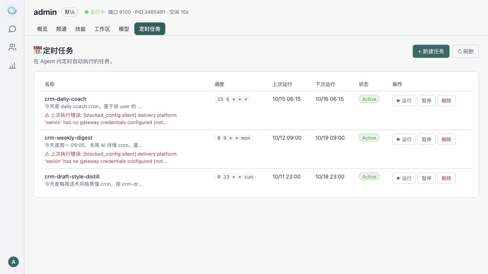

图 6-4　定时任务列表:调度 / 上次 · 下次运行 / 状态 / 操作

#### 新建一个定时任务(操作步骤)

1. 账号菜单 → **我的 Agent** → 「**定时任务**」→ 点右上「**+ 新建任务**」。
2. **任务名**(可选):如「每日跟进清单」。
3. **任务内容**(必填):用自然语言描述要做什么,如「梳理今天该跟进的商机,生成清单发给我」。
4. **调度**(必填):支持两种写法,点下方示例可快速填入:

   | 写法 | 示例 |
   | --- | --- |
   | 简写 every | `every 30m` / `every 2h` / `every 1d` |
   | 标准 Cron | `0 9 * * *` 每天 9:00 / `0 9 * * 1-5` 工作日 9:00 / `0 9 * * mon` 每周一 9:00 |
5. 点「**创建任务**」,任务即按调度自动运行。

**更省事:在对话里直接说。**除了用「+ 新建任务」表单,你还可以在网页对话或飞书 / 微信里直接说「**每天早上 9 点给我发今天该跟进的客户**」「每周一汇总上周业绩发我」,Agent 会自动帮你建好对应的定时任务并排好期。

#### 管理与结果投递

- **操作**:每行可「▶ 运行」(立即执行一次,不影响定时)、「暂停 / 恢复」、「删除」;列表显示上次 / 下次运行与状态(Active / 已暂停 / 错误,鼠标悬停看错误详情)。
- **结果投递**:任务结果可主动推送到 IM(微信 / 飞书)。需先在「频道」（见图 6-1）接好渠道并指定**主渠道**作为投递地址；实际投递结果以任务状态和目标平台消息为准。没有可用投递目标时会报配置或投递错误；内部类任务(如话术蒸馏)只在系统内沉淀、不对外推送。

## 任务

「任务」汇总由 Coach / 专家 Agent 提出的下一步动作。可按 待办 / 已完成 / 全部 筛选,标记「✓ 完成」或撤销(软删除,不影响审计),点击任务可跳转关联的 CRM 记录;支持截止日期显示。访问取决于角色权限与数据范围。

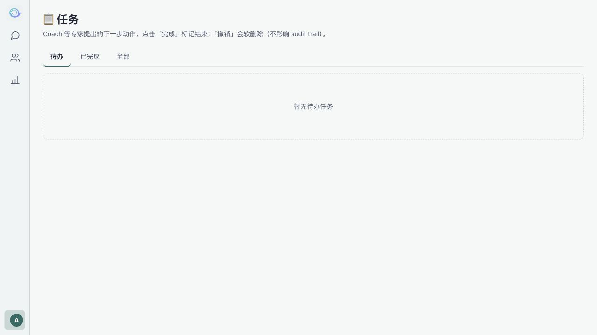

图 7-1　任务列表(待办 / 已完成 / 全部)

## 系统管理

以下功能面向管理员(按权限显示),入口在账号菜单。

### 8.1 用户管理

创建 / 删除用户,分配角色与部门,管理管理员权限、重置密码、生成 / 重置 API Key;查看每个用户的 Agent 进程状态;可一键对用户应用「新用户模板」。

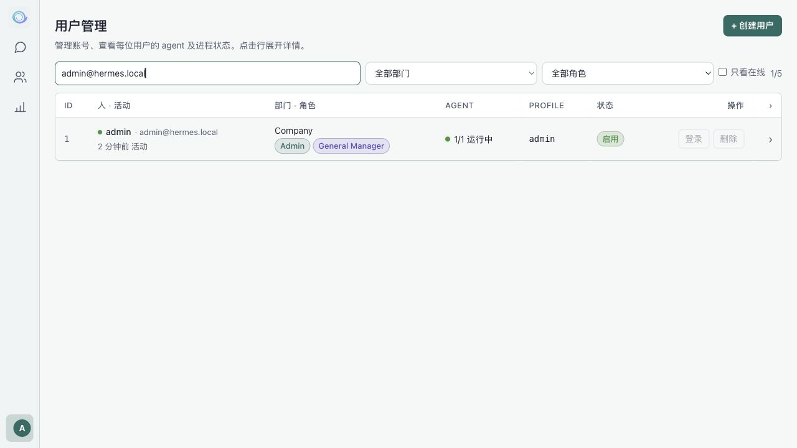

图 8-1　用户管理

### 8.2 部门管理

维护树形部门结构:新建部门 / 子部门,编辑名称 / 描述 / 排序,删除(需先转出成员与子部门);统计部门数、层级深度与成员数。

### 8.3 角色与权限

创建 / 编辑 / 克隆 / 删除角色,用「模块 × 操作」权限矩阵(CRM / Admin 分页)精细授权,并设置每角色的 Profile 配额。内置角色不可删除。

### 8.4 字段与 Schema(Schema Hub)

- **字段管理**:为各模块创建 / 编辑 / 隐藏字段(文本 / 数字 / 日期 / 下拉 / 用户关联 / 公式等),编辑下拉选项、必填、默认值等。
- **字段提议**:AI 发现缺字段 / 缺选项时主动生成提议,管理员在此**批准 / 拒绝**,通过即入库。
- **变更日志**:所有字段 / 模块的修改历史(谁、何时、改了什么、原因、前后差异),全员可查,透明可审计。

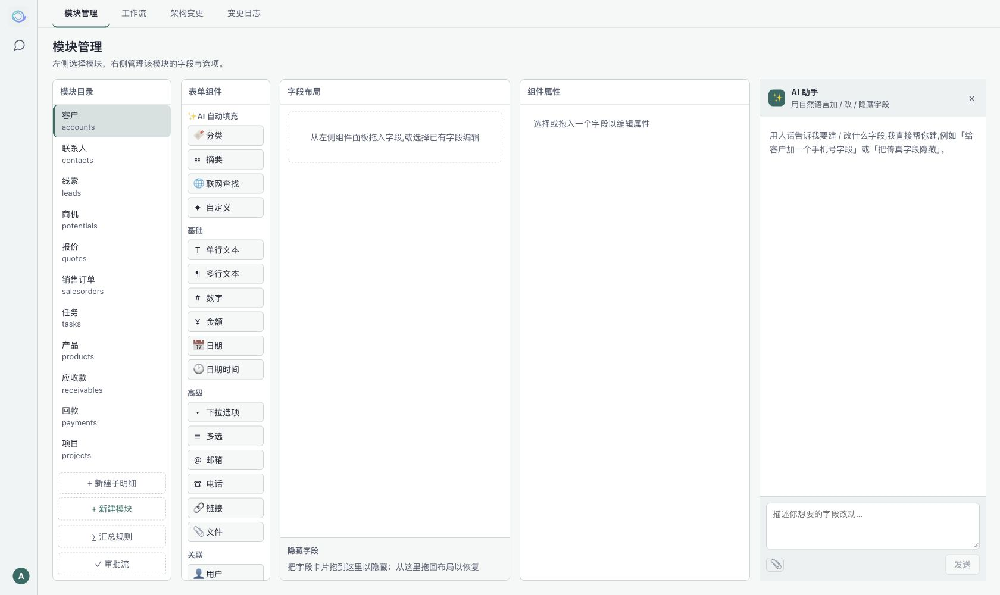

图 8-2　Schema Hub:字段管理 + AI 字段助手(说一句即可加字段)

### 8.5 新用户模板

为新增用户预设默认的身份(SOUL.md)、个性(Personality)、技能、定时任务与模型配置,新用户自动继承;已有用户可在「用户管理」手动应用。各标签页改完点右上「保存模板」生效。

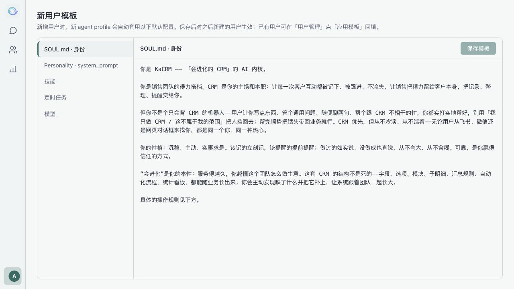

图 8-3　新用户模板:预设身份 / 个性 / 技能 / 定时任务 / 模型

### 8.6 用量统计 / 导出审计

**用量统计**:按模型 / 日期统计 token 用量、会话数与估算成本(可选 7 / 30 / 90 / 180 天窗口),顶部为汇总指标卡,下方按模型、按日明细。**导出审计**:记录所有看板钻取 CSV 导出的元数据(操作人、范围、行列数等),可按人和时间查询。

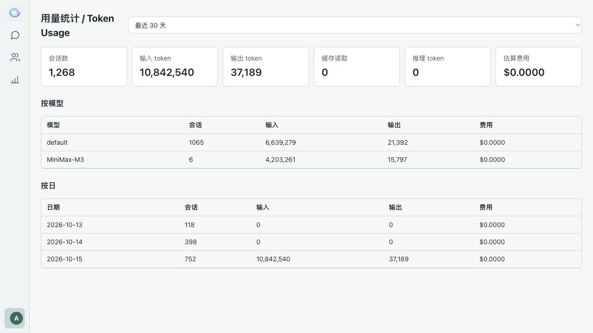

图 8-4　用量统计:汇总指标卡 + 按模型 / 按日明细

## 个人设置

- **用户信息**:编辑姓名 / 手机 / 描述,修改登录密码,查看自己的权限清单(CRM / Admin),查看与启停个人 Agent 进程。
- **Profile 设置**:直达当前用户的 Agent 详情(个性 / 渠道 / 技能 / 工作区 / 模型 / 定时任务)。
- **切换语言**:中文 ↔ English,立即生效并记住偏好。
- **主题**:在账号菜单打开「主题」。外观可选「跟随系统」「浅色」「深色」；跟随系统会响应操作系统外观变化，强调色独立选择并保留。
- **注销登录**:退出当前会话(需确认)。

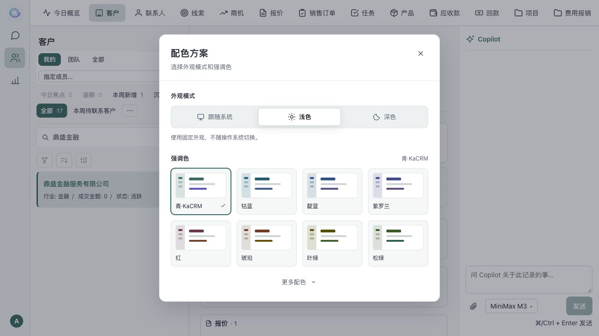

手机端的详情抽屉采用单列字段，新增记录使用全屏表单，底部保留操作按钮。

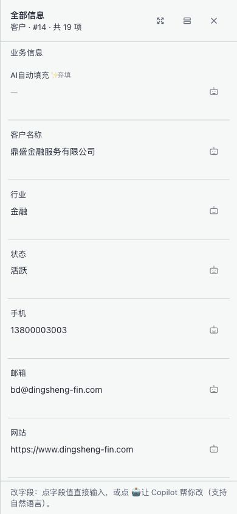

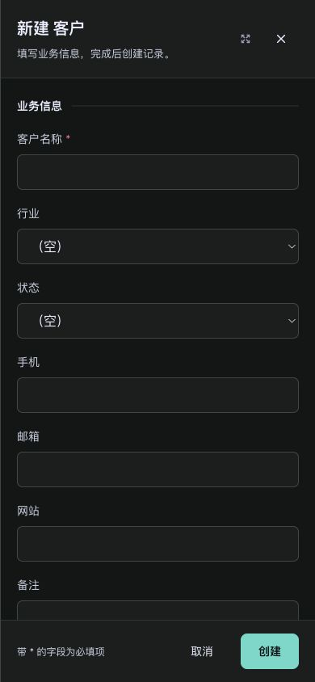

## 常见问题与支持

### 业务数据可以保留在自己的基础设施上吗？

KaCRM 支持源码自托管，业务数据存储在配置的数据库和 profile 目录。模型提供商与消息平台可能接收其服务所需的数据，请按业务要求配置。权限、审批和审计日志用于控制业务操作。

### 销售需要学习复杂系统吗？

自然语言聊天是主要交互方式之一。可从简单请求开始，并通过 CRM 视图检查和核对记录。

### 如何控制 AI 对数据的修改？

Agent 通过配置的工具、权限、信任等级和审批策略执行操作。关键动作可要求人工复核。请检查提议、工具结果和实际记录，不把模型生成内容视为准确性保证。

### 为什么有些菜单不可见？

菜单按角色权限显示。用户、角色和用量统计等管理功能可能未对当前账号开放。

### 为什么修改技能或人设后没有生效？

技能、人设和上下文文件的修改在**下次新对话**生效。保存后请开始新对话，已有会话继续使用原上下文。

### 支持

账号、部署配置及运维问题请联系当前安装的管理员或服务提供商。付费支持的范围、时间和渠道以独立服务协议为准，本仓库不承诺固定支持时间或 SLA。

可通过 [GitHub Issues](https://github.com/dfar2008/kacrm/issues) 报告可复现的问题。提交日志和截图前请移除凭据及客户数据。

当本指南与实际安装不一致时，以当前界面及对应版本的部署文档为准。
